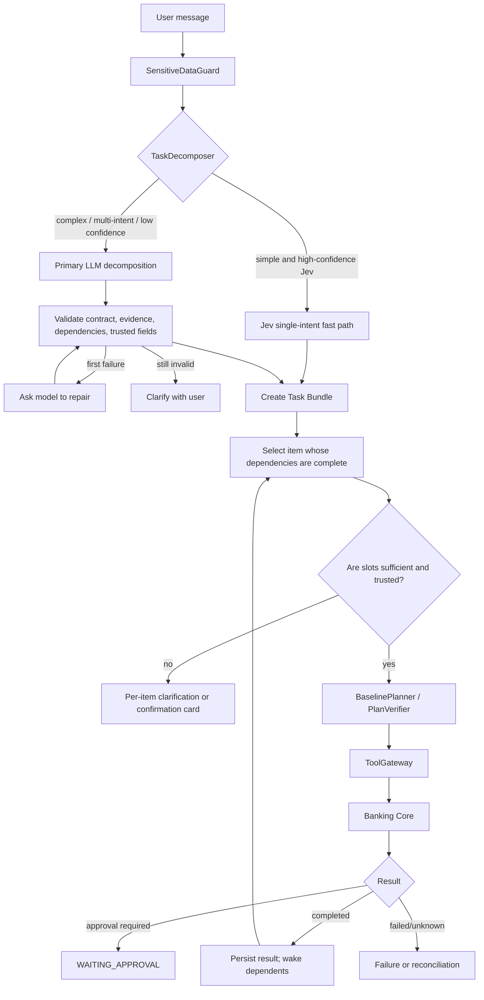

[中文](Algorithm.md) | English

# Aegis Core Algorithms

This document describes the current online language path and financial data kernel. The governing rule is: models propose the most likely structure; deterministic code validates provenance, calculations, capabilities, authorization, and commits.

## 1. End-to-end algorithm

## 2. Task decomposition

`TaskDecomposer` returns a strict `TaskDecomposition`: one to five tasks, each with `item_key`, `intent`, exact-message `evidence`, `proposed_slots`, and `depends_on`. Dependencies must reference other keys in the same output and cannot be self-referential.

### Jev fast path

When enabled, Jev handles a single simple task only if confidence, in-scope probability, and injection-risk conditions satisfy configured thresholds. An injection score alone does not block an ordinary complex request; the decomposition layer also requires an explicit bypass/ignore-rules text signal. Jev failure falls through to the primary LLM instead of failing the user request.

### Primary LLM path

The model must cite evidence from the current message and cannot turn prior conversation actions into new tasks. Recent messages provide reference and context only. Invalid structure or dependencies get one model repair attempt; a second failure becomes clarification rather than guessed execution.

General conversation, such as a greeting, still reaches model routing and returns text; no greeting regex is added. Natural-language savings intents can be recognized, but the current orchestrator marks them `DEFERRED_UNSUPPORTED`.

## 3. Slot provenance and trust

Every fact carries provenance:

| Source | Example | Directly usable for financial writes? |
| --- | --- | --- |
| `USER_EXPLICIT` | User enters CNY 144.00 in a confirmation card | Yes, after type and business validation |
| Core / tool result | Verified balance or owned account | As a read fact; writes still require approval |
| `MODEL_INFERRED` | Model proposes 10% or selects “Mom” from candidates | No; display and require user confirmation |
| Conversation context | A referenced entity in recent messages | Candidate evidence only; cannot override explicit current input |

Models cannot provide user IDs, risk tiers, approval states, or authorization references. `MODEL_INFERRED` values trigger confirmation for financial writes. There is a narrow read-only exception for constrained expense-query `limit` and `category` fields.

A confirmation binds `bundle_id`, `item_id`, the original intent, and allowed fields. A stale UI card therefore cannot be applied to another task.

## 4. Contextual recipient ranking

Recipients are not mapped by name regex:

1. Core returns saved beneficiary candidates owned by the authenticated user.
2. The server creates temporary keys and exposes only key, name, and nickname to the model, together with the request and recent context.
3. The model selects the most likely Top-1 real candidate and provides a short rationale.
4. The server rejects an invalid key, then maps a valid key to the real beneficiary/account ID.
5. The suggestion remains `MODEL_INFERRED`; the user may change it and must confirm.

If the model is unavailable, no candidates exist, or the key is invalid, the UI falls back to manual selection. Current memory is recent session history, not long-term personal memory. If reference resolution remains weak, evaluate persistent summaries, entity memory, and time-bounded reference chains.

## 5. Derived amounts

### Percentage-of-balance transfer

“Check checking balance and send 10% to Mom” becomes `GET_BALANCE → TRANSFER`. After the first item completes, the orchestrator provides `verified_balances` with temporary references, owned accounts, and trusted balances. The model selects a reference and proposes a percentage. The server validates the reference and uses `Decimal` with currency rounding to calculate the absolute amount. Amount, currency, and recipient appear in the confirmation card.

### Split calculation

For bill splitting, the model proposes structured total, participant count, payment direction, and arithmetic meaning. An AA keyword regex does not decide the result. The server checks that the total came from the current message and recalculates with `Decimal`, for example `418 / 2 = 209.00`. Ambiguous count, direction, or amount requires clarification.

The model supplies semantics; deterministic code supplies numerical correctness. Neither alone creates an executable amount.

## 6. Planning and verification

Confirmed structured fields enter deterministic `BaselinePlanner` directly so a router does not reinterpret reviewed data. `PlanVerifier` checks:

- each tool is in the current intent's capability allowlist;
- arguments satisfy Pydantic contracts and provenance requirements;
- node IDs and dependencies are valid and the DAG is acyclic;
- writes have stable idempotency keys;
- untrusted fields do not supply identity, authorization, or risk facts.

Optional Jev plan review is an additional advisory layer. It replaces neither deterministic verification nor Core authorization.

## 7. Tools, approval, and ledger

`ToolGateway` binds each tool to input/output models, a timeout, and a Core HTTP call. Writes usually create a draft before Core creates approval for the exact payload. Yellow approval yields a grant after explicit acceptance; Red also requires simulated MFA. A grant is bound to actor, operation, action, payload hash, and expiry, then consumed on commit.

Transfer commit locks resources in a database transaction, checks state and balance, creates balanced ledger entries, and updates business state. Money uses `Decimal`, not binary floating point. When the Agent only has a draft or approval state, it must say “waiting for approval,” never that funds arrived.

## 8. State, recovery, and reconciliation

Task Bundles persist user-visible multi-item state; Durable Tasks persist an item's plan, result, and events; LangGraph checkpoints persist graph position; Core persists financial state. Approval resumption passes the grant reference to the associated item without exposing it to model context.

A timed-out write has an unknown outcome. The system prefers status lookup or recovery with the same idempotency key. If it cannot determine the outcome, it reports reconciliation information instead of blindly retrying with a new key. “Human takeover” currently means a Durable Task state transition, not an integrated human-operator platform.

## 9. Known limits

- LLM and Jev accuracy depends on model and configuration; one repair attempt cannot parse every complex request.
- A bundle contains at most five items, and completed independent items are not automatically compensated when a later item fails.
- Session context is not long-term personal memory.
- Natural-language savings execution is deferred.
- External model calls add latency; deadlines and fallbacks require deployment-specific tuning.

