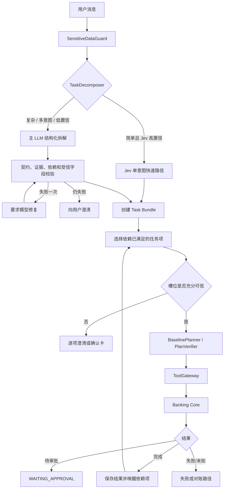

中文 | [English](Algorithm.en.md)

# Aegis 核心算法

本文描述当前在线自然语言链路和金融数据内核。核心原则是：模型负责提出最可能的结构，确定性代码负责验证来源、计算、能力、授权和提交。

## 1. 端到端算法

## 2. 任务拆解

`TaskDecomposer` 的输出是严格的 `TaskDecomposition`：一到五个任务，每项有 `item_key`、`intent`、原文 `evidence`、`proposed_slots` 和 `depends_on`。依赖只能引用同一输出中的其他 key，不允许自依赖。

### Jev 快速路径

启用 Jev 后，只有同时满足配置阈值、in-scope 阈值和注入风险条件的简单高置信请求才走单任务快速路径。注入分数不能单独阻断普通复杂请求；任务拆解层还要求文本出现明确的绕过/忽略规则信号。Jev 不可用时继续主 LLM，不把外部分类故障当成用户请求失败。

### 主 LLM 路径

模型必须引用本轮消息中的证据，不能把旧对话里的动作当作新任务。最近会话消息只用于指代和语境。结构解析失败或违反依赖/字段契约时允许一次修复；仍失败则返回澄清，而不是猜测执行。

普通对话（例如问候）仍进入模型路由并返回文本，不通过新增问候正则硬编码。自然语言储蓄罐意图能够被识别，但当前编排器将其标为 `DEFERRED_UNSUPPORTED`。

## 3. 槽位来源与信任

每个事实都携带来源。常见来源及处理如下：

| 来源 | 示例 | 是否可直接用于金融写入 |
| --- | --- | --- |
| `USER_EXPLICIT` | 用户在确认卡输入 CNY 144.00 | 经类型与业务校验后可以 |
| Core / 工具结果 | 已验证余额、当前用户账户 | 可以作为只读事实；写入仍须审批 |
| `MODEL_INFERRED` | 模型从“10%”建议比例、从候选中建议“妈妈” | 不可以；必须显示并由用户确认 |
| 对话上下文 | 最近消息中的指代对象 | 只作为候选依据，不能覆盖当前任务的明确输入 |

模型不能提供用户 ID、风险等级、审批状态或授权引用。对金融写入，`MODEL_INFERRED` 字段会触发确认；只读消费查询对经过约束的 `limit` 和 `category` 有窄例外。

确认请求绑定 `bundle_id`、`item_id`、原 intent 和允许字段。这样即使页面保留旧卡片，后端也不会把它应用到另一任务。

## 4. 上下文收款人排序

收款人不是靠姓名正则直接映射。算法为：

1. Core 返回当前认证用户已保存的 beneficiary 候选。
2. 服务端为候选生成临时 key，只向模型提供 key、姓名和昵称，以及当前请求和最近对话。
3. 模型必须在真实候选中选择最可能的 Top-1 并给出简短依据。
4. 服务端拒绝非法 key，再映射为真实 beneficiary / account ID。
5. 推荐仍标为 `MODEL_INFERRED`，用户可修改并必须确认。

模型不可用、没有候选或返回非法 key 时退回人工选择，不伪造收款人。当前记忆是会话内最近消息；如果长期指代效果不足，应评估持久摘要、实体记忆和带时效的指代链。

## 5. 派生金额

### 百分比余额转账

“查询活期余额并将 10% 转给妈妈”会拆成有依赖的 `GET_BALANCE → TRANSFER`。余额任务完成后，编排器向后续任务提供 `verified_balances`，其中包含临时引用、账户和可信余额。模型只能选择引用并提出百分比；服务端验证引用后使用 `Decimal` 和货币舍入计算绝对金额。绝对金额、币种和收款人最终出现在确认卡中。

### 分摊计算

AA 场景由模型提出结构化的总额、人数、付款方向和算式含义，不由 AA 关键词正则直接决定结果。服务端验证总额确实来自本轮请求，再用 `Decimal` 复算，例如 `418 ÷ 2 = 209.00`。人数、方向或金额存在歧义时必须澄清。

模型负责语义，确定性计算器负责数值正确性。两者任一不可靠都不能形成可执行金额。

## 6. 计划生成与验证

用户确认后的结构化字段直接进入确定性 `BaselinePlanner`，避免再次让路由模型重解释已审核数据。`PlanVerifier` 检查：

- 工具是否在当前 intent 的 capability allowlist 中；
- 参数是否满足 Pydantic 输入契约及来源要求；
- 节点 ID 和依赖是否合法、DAG 是否无环；
- 写操作是否具备稳定幂等键；
- 不受信字段是否试图提供身份、授权或风险事实。

可选 Jev plan review 是额外建议层，不替代上述验证，也不复核已确认字段的业务授权。

## 7. 工具执行、审批与记账

`ToolGateway` 为每个工具绑定输入/输出模型、超时和 Core HTTP 调用。写操作通常先创建草稿，再由 Core 对精确负载创建审批。Yellow 审批经明确同意获得授权；Red 审批还需要模拟 MFA。授权与 actor、operation、action、payload hash 和过期时间绑定，并在提交时消费。

转账提交在数据库事务中锁定相关资源，检查状态与余额，写入平衡的 ledger entries，再更新业务状态。金额使用 `Decimal`，不用二进制浮点数。Agent 收到草稿或审批状态时只能报告“待审批”，不能报告资金已到账。

## 8. 状态、恢复与对账

Task Bundle 保存用户可见的多项任务状态；Durable Task 保存单项执行计划、结果和事件；LangGraph checkpoint 保存图运行位置；Core 保存金融业务状态。审批恢复接口把授权引用交给关联任务项继续执行，授权引用不进入模型上下文。

网络超时后的写结果可能未知。系统优先使用同一幂等键查询或恢复，无法确认时返回待对账信息，不用新键盲目重试。人工接管当前主要是持久任务状态迁移，不等于已接入人工坐席系统。

## 9. 已知限制

- LLM 与 Jev 的准确率受模型和配置影响；一次修复不能保证任意复杂请求都可解析。
- 最多五个任务项，且已完成的独立项不会因后续项失败而自动补偿回滚。
- 会话上下文不是长期个人记忆。
- 自然语言储蓄罐执行暂缓。
- 外部模型调用会增加延迟；超时预算和降级路径需要结合部署环境调优。

