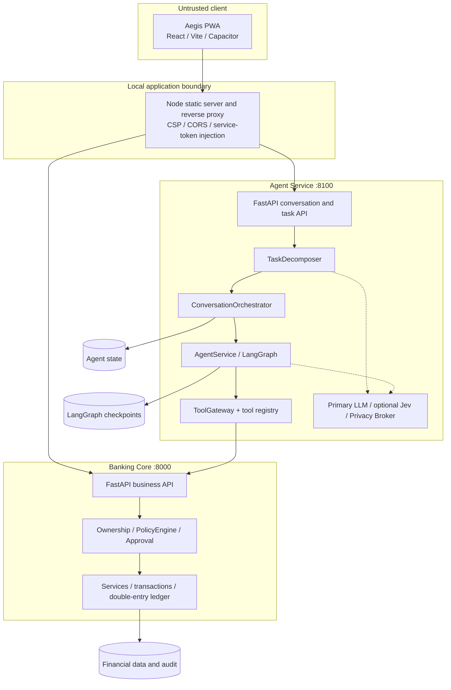
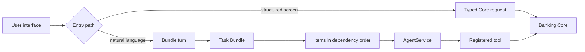
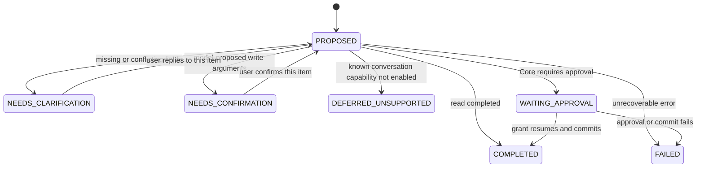
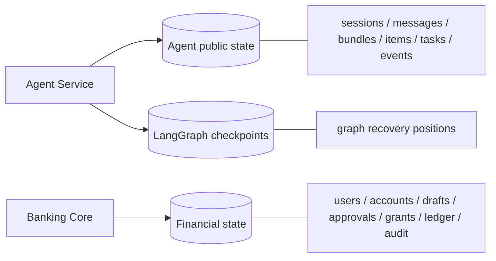

[中文](Architecture.md) | English

# Aegis Architecture

Aegis separates understanding a user from changing financial state. The Agent may propose intents, arguments, and plans; only Banking Core can decide ownership, issue authorization, and commit financial transactions.

## 1. Runtime components



### Aegis PWA and Node proxy

The PWA exposes accounts, transfer, budget, card, wealth, savings, and conversation screens. The browser calls same-origin `/api/core/*` and `/api/agent/*` routes. `frontend/aegis-pwa/server.mjs` removes browser authentication headers, injects separate Core and Agent service tokens, and applies CSP, CORS, and `no-store` API caching. The Capacitor shell uses a restricted origin list.

### Agent Service

`agent/app.py` is the online composition root. It exposes the v2 `/agent/bundles/turns` flow and approval resumption, the compatible single-turn endpoint, Durable Task create/query/resume/cancel/takeover/event endpoints, and optional receipt, speech, and proactive APIs.

The Agent decomposes, clarifies, confirms, plans, and orchestrates. It reaches Core only through `ToolGateway` and registered tools; it cannot write Core ORM state directly.

### Banking Core

Core is authoritative for financial facts. It independently enforces service authentication, development-user mapping, ownership, policy, approval/MFA, grant consumption, idempotency, row locking, business state transitions, and double-entry bookkeeping. It rejects unauthorized values even if an Agent or model proposes them.

## 2. Two user paths



Structured screens skip language interpretation but never skip Core checks. The natural-language path adds Task Bundles and Parameter Confirmation; both paths share the same Core business and authorization rules.

## 3. Multi-intent Task Bundles



`TaskDecomposer` returns at most five `ProposedTask` objects, each with a stable key, intent, exact evidence, candidate slots, and dependency keys. `ConversationOrchestrator` persists them as a Task Bundle and executes an item only after its dependencies complete. A form confirmation must match bundle, item, and intent, preventing a stale card from modifying a new task.

Aggregate bundle states are `RUNNING`, `NEEDS_CLARIFICATION`, `NEEDS_CONFIRMATION`, `WAITING_APPROVAL`, `PARTIALLY_COMPLETED`, `COMPLETED`, and `FAILED`. Failure of one independent item does not roll back already completed items; the UI must show per-item results.

## 4. Dependent fact flow: percentage transfer

```mermaid
sequenceDiagram
    participant U as User
    participant O as Orchestrator
    participant C as Banking Core
    participant M as LLM
    U->>O: Check checking balance, send 10% to Mom
    O->>C: get_balance(checking)
    C-->>O: verified 1440.00 + account reference
    O->>M: request + recent context + verified_balances + recipient candidates
    M-->>O: percentage=10, balance_ref=..., recipient_key=...
    O->>O: validate references; Decimal calculation = 144.00
    O-->>U: confirm account, Mom, CNY 144.00
    U->>O: Parameter Confirmation
    O->>C: create draft and enter Core approval chain
```

The model does not supply the balance or a real recipient account ID. The balance comes from a completed dependency. The recipient ranker sees only temporary keys, names, and nicknames; the server maps a validated key to the real ID. Currency defaults to CNY and remains visible in the confirmation card.

## 5. Data and persistence responsibilities



All three may share one PostgreSQL instance, but their responsibilities differ:

- **Agent public state** uses `AGENT_DATABASE_URL` and Alembic-managed tables for sessions, messages, bundles, items, Durable Tasks, and events.
- **LangGraph checkpoints** use `AGENT_CHECKPOINT_DATABASE_URL`; without it, the online process falls back to memory and loses checkpoints on restart.
- **Financial state** uses `DATABASE_URL` for Core domain facts, approvals, grants, ledger entries, and audit records.

Core completion state outranks Agent presentation state. After a network timeout, an Agent error message alone does not prove that funds remained unchanged; reconcile by task ID, Trace ID, and Core status.

## 6. Models and Jev

The primary LLM handles complex decomposition, structured candidates, recipient ranking, and conversational responses. When `JEV_ENABLED=true` and a valid key is configured, Jev may handle high-confidence simple classification, expense labeling, and optional plan review. Low confidence, unavailability, or invalid structure leads to the primary LLM, repair, or clarification. Jev never chooses risk tiers or receives grants.

With `PRIVACY_BROKER_ENABLED=true`, model-bound text passes through deterministic best-effort redaction. This is not complete anonymization; see [Security](Security.en.md).

## 7. Deployment status

`docker-compose.yml` currently orchestrates PostgreSQL and Banking Core. Start Agent and PWA separately as described in the root README. Default communication is local HTTP with service tokens; TLS and mTLS are absent. Production hardening needs an identity provider, secret management, transport encryption, database isolation and backups, centralized logs, and monitoring/alerting.

