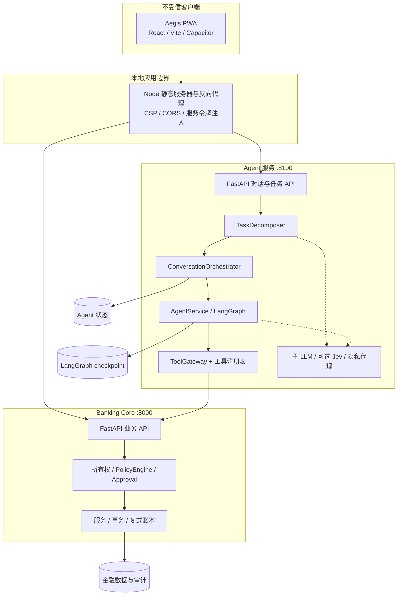
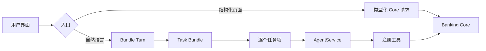
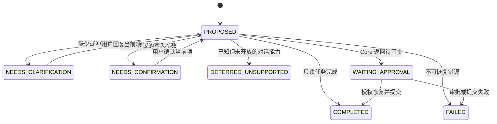
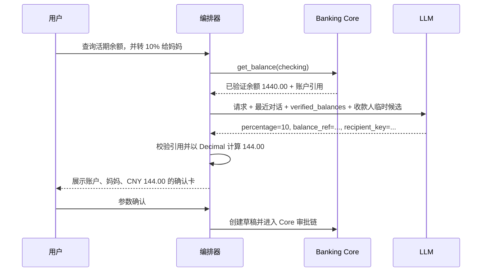
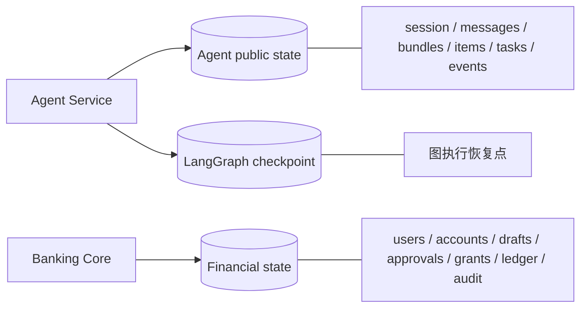

中文 | [English](Architecture.en.md)

# Aegis 总体架构

Aegis 将“理解用户”和“改变金融状态”分离。Agent 可以提出意图、参数和执行计划，但只有 Banking Core 能判断资源归属、签发授权并提交金融事务。

## 1. 运行时组件

### Aegis PWA 与 Node 代理

PWA 提供账户、转账、预算、卡片、理财、储蓄目标和对话界面。浏览器只访问同源的 `/api/core/*` 与 `/api/agent/*`。`frontend/aegis-pwa/server.mjs` 删除浏览器提供的认证头，分别注入 Core 和 Agent 服务令牌，并设置 CSP、CORS 与 `no-store` API 缓存策略。Capacitor 原生壳使用受限来源列表。

### Agent 服务

`agent/app.py` 是在线装配入口。它提供：

- v2 多轮入口 `/agent/bundles/turns` 与审批恢复接口；
- 兼容的单次 `/agent/requests`；
- Durable Task 的创建、查询、恢复、取消、人工接管和事件流；
- 可选票据解析、语音转写和主动建议接口。

Agent 的职责是拆解、澄清、确认、规划和编排。它只经 `ToolGateway` 调用注册工具，不能直接写 Core 数据库。

### Banking Core

Core 是金融事实权威。它独立完成服务认证、开发用户映射、资源所有权检查、策略评估、审批/MFA、授权消费、幂等控制、行锁、业务状态迁移和复式记账。即使 Agent 或模型提出越权参数，Core 仍会拒绝。

## 2. 两条用户路径

结构化页面跳过自然语言理解，但不会跳过 Core 安全检查。自然语言路径多一层任务束和参数确认；进入 Core 后，两条路径共享相同的业务与授权规则。

## 3. 多意图任务束

`TaskDecomposer` 最多输出五个 `ProposedTask`，每项包含稳定 key、意图、原文证据、候选槽位和依赖 key。`ConversationOrchestrator` 把它们持久化为 Task Bundle，只有依赖已完成的任务项才可执行。表单确认必须同时匹配 bundle、item 和 intent，防止旧卡片修改新任务。

任务束聚合状态包括 `RUNNING`、`NEEDS_CLARIFICATION`、`NEEDS_CONFIRMATION`、`WAITING_APPROVAL`、`PARTIALLY_COMPLETED`、`COMPLETED` 和 `FAILED`。某项失败不会把已成功的独立项回滚；界面必须逐项呈现结果。

## 4. 依赖事实流：余额百分比转账

模型不负责提供余额或真实收款账户 ID。余额来自已完成依赖项；收款人模型只看到临时候选 key、姓名和昵称，服务端再映射真实 ID。币种缺省为 CNY，但仍会显示在确认卡中。

## 5. 数据与持久化职责

三类数据可以使用同一个 PostgreSQL 实例，但不可混淆：

- **Agent public state** 使用 `AGENT_DATABASE_URL`，由 Alembic 迁移管理，保存会话、消息、任务束、任务项、持久任务和事件。
- **LangGraph checkpoint** 使用 `AGENT_CHECKPOINT_DATABASE_URL`；未配置时在线进程回退到内存 checkpoint，重启后不保留。
- **Financial state** 使用 `DATABASE_URL`，保存 Core 领域事实、审批授权、账本和审计。

Core 的金融完成状态高于 Agent 的展示状态。发生网络超时时，不能仅凭 Agent 失败消息推断资金未变动，应使用任务 ID、Trace ID 和 Core 状态对账。

## 6. 模型与 Jev 的位置

主 LLM 处理复杂拆解、结构化候选、收款人排序和自然对话。Jev 在 `JEV_ENABLED=true` 且 API key 有效时可参与高置信简单分类、消费标注和可选计划复核。低置信、服务不可用或结构非法时转主 LLM、修复或澄清；Jev 不决定风险等级，也不持有授权。

`PRIVACY_BROKER_ENABLED=true` 时，模型出站文本先经过确定性尽力脱敏。此层不是完整匿名化，详细边界见[安全设计](Security.md)。

## 7. 部署现状

`docker-compose.yml` 当前编排 PostgreSQL 与 Banking Core。Agent 和 PWA 按根目录 README 分别启动。默认通信是本机 HTTP 加服务令牌，不包含 TLS 或 mTLS。生产化时至少需要独立身份提供方、密钥管理、网络加密、数据库隔离/备份、集中日志和监控告警。

