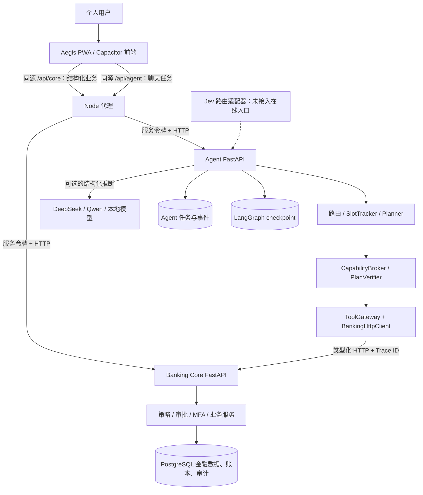
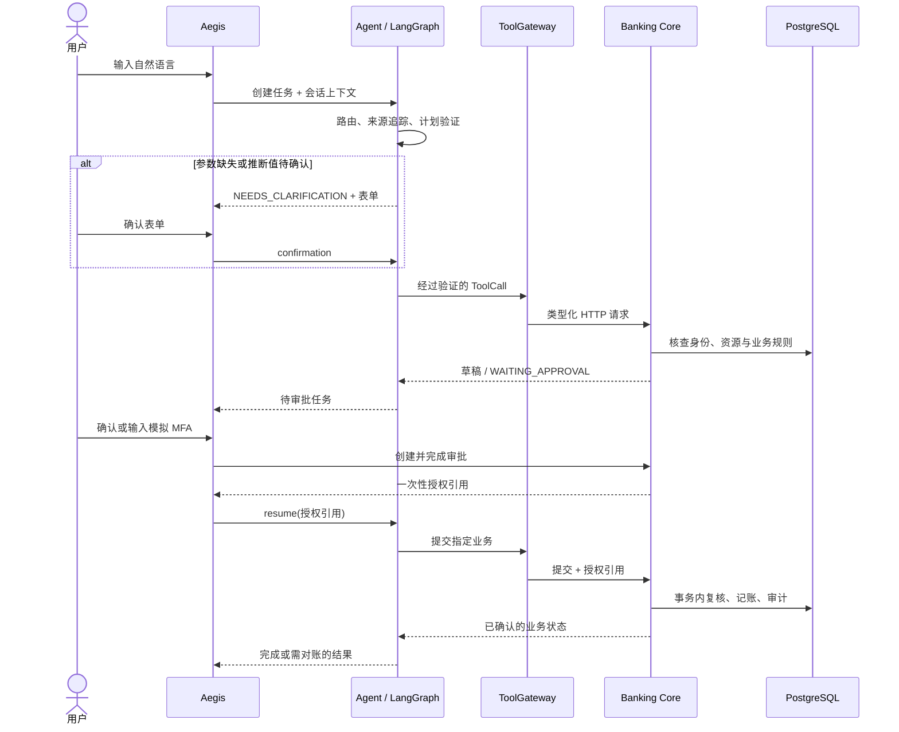
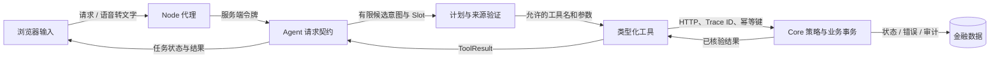

# 总体架构

[返回文档总览](README.md) · [核心算法](Algorithm.md) · [安全设计](Security.md)

Aegis 把自然语言理解和金融状态变更放在两个独立模块中。页面请求与聊天请求先进入 Node 代理：前者直接调用 Banking Core，后者交给 Agent。Agent 只能通过有类型的工具接口访问 Core；账户余额、业务状态和审批结果最终以 Core 保存的事实为准。下图描述当前仓库的主要运行路径，虚线表示可选或尚未启用的路径。

图中的三个数据库形状表示**数据职责**，不表示必须部署三个数据库实例。默认配置可将 Core 表、Agent 公开任务表与 LangGraph checkpoint 放在同一 PostgreSQL 实例。Core 由 [`banking_core/app/main.py`](../banking_core/app/main.py) 装配；Agent 由 [`agent/app.py`](../agent/app.py) 装配；前端代理位于 [`frontend/aegis-pwa/server.mjs`](../frontend/aegis-pwa/server.mjs)。

## 两条请求路径

结构化页面已经知道要办理的业务。例如转账页面收集收款账号、金额与付款账户，直接经 `/api/core` 调用 Core 的草稿和审批接口。这里不经过 LLM，但同样受 Core 的所有权、风控、授权和幂等规则约束。Aegis 的聊天页经 `/api/agent` 创建任务；模型或规则只生成候选意图与参数，Agent 在调用工具前进行确定性验证。

代理在转发时覆盖浏览器提交的 `Authorization`，为 Core 和 Agent 分别注入服务端令牌。原生 Capacitor 应用通过配置的代理地址访问后端；仓库提供开发代理和允许来源列表，公开部署仍需单独配置 HTTPS、正式认证与密钥管理。参见 [`server.mjs`](../frontend/aegis-pwa/server.mjs) 与 [`vite.config.ts`](../frontend/aegis-pwa/vite.config.ts)。

## Agent 内部的模块接口

| 模块 | 对调用方暴露的接口与责任 | 关键实现 |
| --- | --- | --- |
| 路由与参数提取 | 返回结构化 `IntentResult`，再把明确事实与模型推断分开。 | [`agent/hybrid.py`](../agent/hybrid.py)、[`agent/context.py`](../agent/context.py) |
| 计划与验证 | 接收候选 `TaskPlan`，检查依赖、动作权限、参数来源和 Tool Schema。 | [`agent/planning.py`](../agent/planning.py)、[`agent/capabilities.py`](../agent/capabilities.py) |
| 工具接口 | 在 HTTP 接缝处验证入参与出参，传递服务凭据、幂等键和 Trace ID。 | [`agent_tools/gateway.py`](../agent_tools/gateway.py)、[`agent_tools/client.py`](../agent_tools/client.py) |
| 持久任务 | 将公开任务状态与运行图 checkpoint 分开；审批后恢复执行。 | [`agent/durable.py`](../agent/durable.py)、[`agent/graph.py`](../agent/graph.py) |
| 金融内核 | 在事务中执行业务规则、授权校验、资金变动、记账与审计。 | [`banking_core/app/services`](../banking_core/app/services/)、[`banking_core/app/security`](../banking_core/app/security/) |

ToolGateway 和 Core HTTP 接口是有实际价值的接缝：前端和 Agent 都复用 Core 规则，Agent 的测试可替换 HTTP 适配器，而金融数据库始终由 Core 所有。`JevRoutingBoundary` 已单独实现并有测试，但 [`agent/app.py`](../agent/app.py) 尚未装配它，不能把虚线理解为当前在线流量。

## 自然语言任务如何推进

下图以需要审批的金融写操作为例。普通只读查询在工具返回后即可完成；缺少参数时会先进入澄清表单。下图的“授权”指 Banking Core 发出的、与具体操作绑定的凭证，不是模型或前端自行声明的许可。

批准流程的 API 由 Core 的 [`api/security.py`](../banking_core/app/api/security.py) 提供；LangGraph 的在线运行图在 [`build_runtime_agent_graph`](../agent/graph.py) 中处理暂停、恢复和结果未知时的查询对账。当前并没有通用的业务补偿节点；“取消任务”也不等于撤销已经入账的交易。

## 安全保证：每个输入输出在哪里受控

- **浏览器 → 代理：** 代理替换传入的认证头，仅从服务器环境读取服务令牌。前端不承担银行身份判定。来源检查限制跨域调用，但它不是用户登录机制。
- **代理 → Agent：** `AgentRequest` 拒绝明显的认证秘密和非法字段；开发身份由服务端配置注入。用户文本及模型候选始终按不可信输入处理。
- **Agent → 工具：** `CapabilityBroker` 缩小可用动作，`PlanVerifier` 拒绝未知工具、循环依赖和模型推断的执行参数；Gateway 校验请求与响应模型。
- **工具 → Core：** Core 再查资源归属与操作状态，按风险决定确认或模拟 MFA。一次性授权须匹配当前操作及请求内容，资金写入发生在事务内。
- **Core → Agent → 用户：** 金融结果取自 Core，Agent 保存任务状态并据此组织回答。未知写入结果会查询状态；查不到确定结果时不报告成功。

各控制点的代码与未覆盖范围见[安全设计](Security.md)。

## 部署与持久化边界

`docker-compose.yml` 目前只声明 PostgreSQL 和 Banking Core 容器；Agent 与 Aegis 可按各自入口另启进程。Agent 配置了 PostgreSQL checkpoint 时会在启动期装配持久化 saver；未配置时在线图使用 `MemorySaver`，不能跨进程重启恢复图状态。Agent 任务表仍依赖独立配置的数据库连接。区分公开任务表、图 checkpoint 和 Core 的金融表，可避免把“任务显示完成”误当作“金融事务已提交”。

本地 Core 和 Agent 默认以 HTTP 通信，并使用静态开发服务令牌；仓库没有实现进程间 TLS/mTLS 或报文加密。要部署到真实网络，应增加正式身份认证、传输加密、密钥托管与网络访问控制。当前架构属于可验证的演示系统架构，而非生产银行接入方案。
