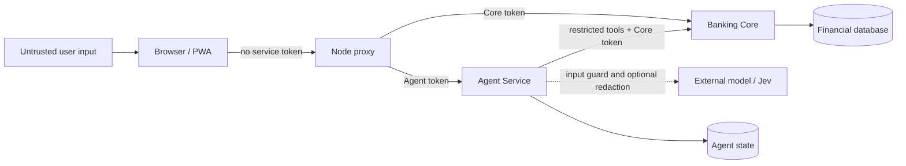
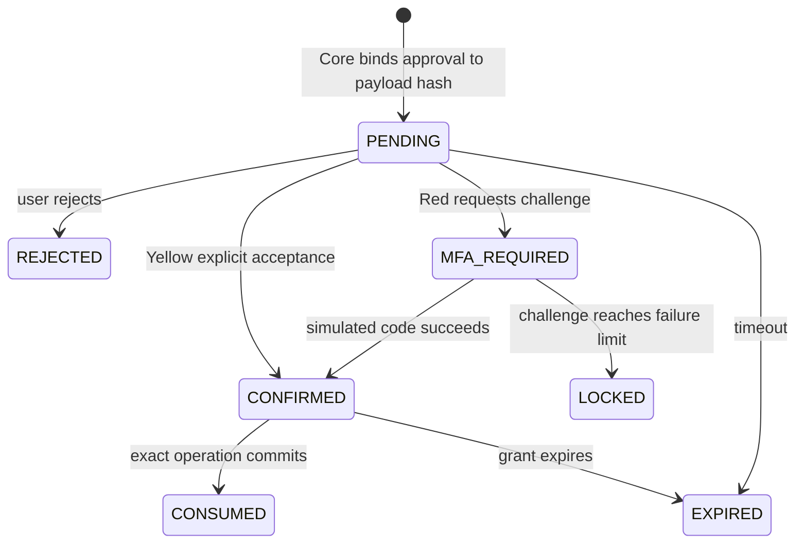

[中文](Security.md) | English

# Aegis Security Design

Aegis does not depend on a model being obedient. Its primary security objective is to prevent a model from independently authorizing or committing a financial action. This document separates implemented controls, optional protections, and production gaps.

## 1. Trust boundaries and threat model

Threats include prompt injection, hallucinated success, cross-user access, stale-card replay, argument tampering, approval/commit payload mismatch, duplicate writes, unknown timeout outcomes, secrets sent to models, and development tokens used outside local environments.

The browser, user text, and model output are untrusted. Agent is a constrained orchestrator. Core and its database form the financial execution boundary. Full compromise of a service process or database host is outside this prototype's protection scope.

## 2. Identity and service tokens

- The browser never holds `BANKING_SERVICE_TOKEN` or `AGENT_API_TOKEN`.
- The Node proxy removes browser `Authorization`, Cookie, Origin, and Referer headers and injects the correct upstream token.
- Core and Agent establish the actor from a service token or development configuration, never from a model-supplied `user_id`.
- Core rechecks actor ownership on every resource read and write.

Default tokens are local-development values. The repository does not implement production login, OAuth/OIDC, token rotation, or hardware-backed secret storage.

## 3. Input, model egress, and injection defenses

Before any external model call, `SensitiveDataGuard` rejects text marked as containing a password, verification/MFA code, CVV/CVC, or full card number. When enabled, `PrivacyBroker` deterministically replaces a limited set of identifiers in model-bound text. It is best-effort protection, not a DLP or anonymization guarantee.

Models receive only the data needed for a decision. Recipient ranking uses temporary keys, names, and nicknames, not internal UUIDs or full account numbers. Percentage calculation uses temporary balance references and verified balances. Authorization references never enter model arguments.

Task decomposition is constrained by Pydantic structure, exact evidence, field allowlists, and dependency checks. Explicit ignore-rules/bypass-approval text combined with Jev risk can block a request. This does not recognize every injection variant, so final security still relies on the Core authorization boundary.

## 4. Capabilities and argument provenance

`CapabilityBroker` maps an intent to allowed tools. `PlanVerifier` rejects unapproved tools, invalid DAGs, and untrusted argument provenance. A model cannot declare identity, risk tier, approval result, or authorization.

Model-proposed financial-write fields are `MODEL_INFERRED` and must appear in a confirmation form bound to the specific Bundle Item. Parameter Confirmation is not Risk Approval. The backend rejects stale cards, mismatched intents, and unlisted fields.

## 5. Risk approval and strong verification

Core's `PolicyEngine` chooses the tier:

- Green: reads such as balance, transactions, bills, and investment returns;
- Yellow: explicit confirmation; transfer based on daily reserved-plus-committed total up to CNY 1,000, and per-contribution savings up to CNY 1,000;
- Red: transfers/savings above threshold, card loss report, and wealth subscription/redemption, with simulated MFA.

Approval records actor, operation, action, target, amount, currency, and payload hash. Grants are short-lived and single-use. Core recomputes and compares the current payload at commit; changing amount, account, or action invalidates the old grant.

The simulated MFA challenge expires, limits attempts, and is single-use. Three failures trigger a 15-minute safety lock. This is a test implementation, not SMS, TOTP, biometrics, or bank-grade strong customer authentication.

## 6. Financial integrity

- Money uses `Decimal` and explicit currency precision, not binary floating point.
- Writes use idempotency keys; retries for the same operation reuse the original key.
- Transfer drafts have states and expiry; daily risk totals include pending-authorization, authorized, processing, and completed drafts.
- Commit transactions use database locks and state checks to prevent balance races and double grant consumption.
- Transfers create balanced debit/credit ledger entries; balances derive from ledger facts.
- Agent cannot write financial ORM state; all financial changes pass through Core services.

## 7. Result integrity and recovery

Natural-language responses may use only verified bundle state and tool results. Draft, confirmation, approval, failure, and deferred states must never be described as successful. A timed-out write may have an unknown outcome; recovery uses the same idempotency key and Core status lookup. If unresolved, the system reports a reconciliation requirement.

Task Bundles, Durable Tasks, Agent events, Trace IDs, Core audit events, and ledger entries provide evidence at different layers. They aid investigation, but there is no complete administrator audit-query product and the system does not claim to persist a model's private reasoning.

## 8. Web and transport protections

The Node server applies CSP, `X-Content-Type-Options: nosniff`, `Referrer-Policy: no-referrer`, a permissions policy, and restricted CORS. Unknown cross-origin callers do not reach the token-injecting proxy. API responses use `Cache-Control: no-store`.

Default service connections use HTTP on `127.0.0.1`. The repository does not include TLS, mTLS, a WAF, or network policy; non-local deployments must supply them. CSP permits inline styles and WASM required by the current build and does not eliminate all XSS risk.

## 9. Data disclosure matrix

| Data | Browser | Agent | External model / Jev | Banking Core |
| --- | --- | --- | --- | --- |
| Service tokens | No | As needed for Agent/Core calls | No | Validates them |
| Actor user ID | Not a controllable business argument | Trusted context | No | Yes |
| Full account/internal UUID | Shown only where structured UI needs it | As needed for tools | Not exposed for recipient ranking | Yes |
| Balance | May be displayed | Verified fact | Temporary reference and balance only when needed for derivation | Authority |
| MFA code | Separate verification form | Excluded from model context | No | Challenge validation |
| Authorization reference | Used only by resume UI; hide from logs | As needed by resume tool | No | Issues and consumes it |
| Conversation text | Yes | Yes | Configuration-dependent, guarded and optionally redacted | Usually no |

## 10. Known gaps

- Development identity and simulated MFA are not production authentication.
- Privacy Broker cannot guarantee removal of all PII; external-provider handling also depends on provider terms.
- Prompt-injection controls are layered mitigation, not a formal proof.
- Defaults lack transport encryption, secret rotation, centralized SIEM, rate limiting, malware scanning, and compliance retention policy.
- Agent, checkpoint, and Core data may share one database instance; production should isolate privileges and backups according to its threat model.
- Passing tests is not penetration testing, compliance certification, or a production security assessment.

