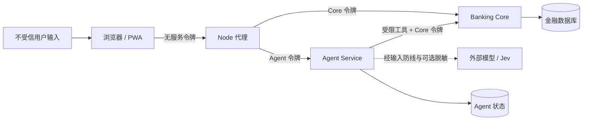
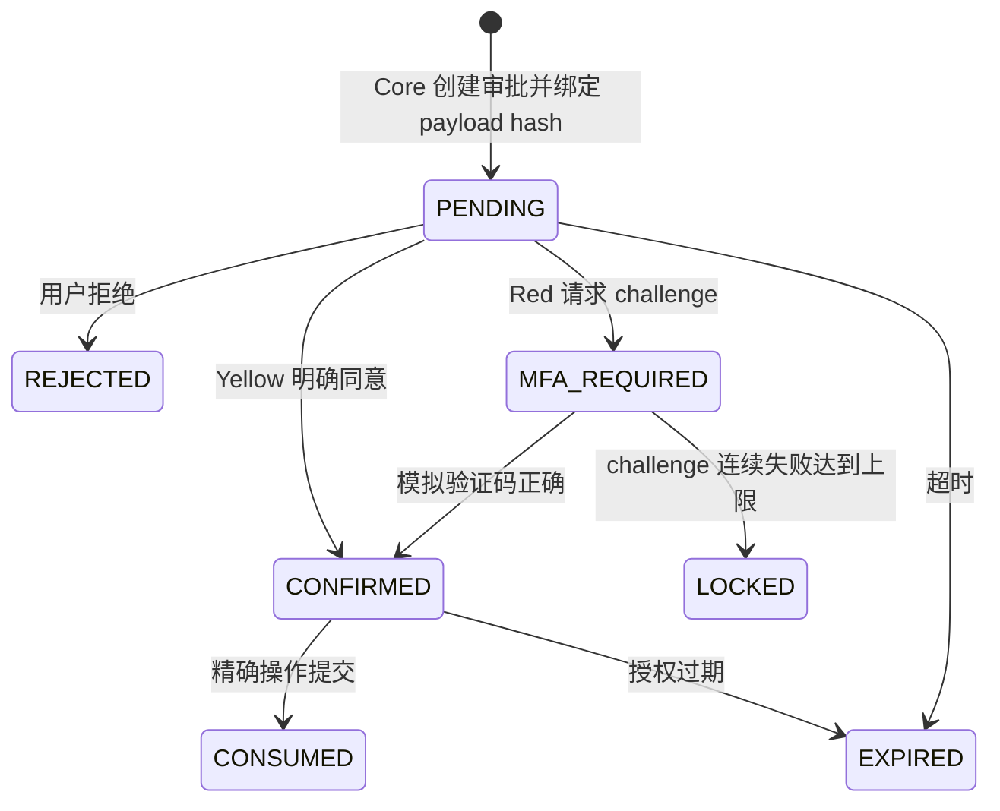

中文 | [English](Security.en.md)

# Aegis 安全设计

Aegis 的安全目标不是让模型“足够听话”，而是让模型无法独自授权或提交金融动作。本文区分已实现控制、可选保护和生产环境缺口。

## 1. 信任边界与威胁模型

主要威胁包括：提示注入、模型幻觉、跨用户资源访问、旧确认卡重放、参数篡改、审批与提交负载不一致、重复写入、网络超时造成未知结果、敏感信息进入外部模型，以及开发令牌误用于非本地环境。

基本假设：浏览器、用户文本和模型输出都不受信；Agent 是受限编排者；Core 和数据库是金融执行信任边界。服务进程或数据库主机完全失陷不在当前原型的防御范围内。

## 2. 身份与服务令牌

- 浏览器不持有 `BANKING_SERVICE_TOKEN` 或 `AGENT_API_TOKEN`。
- Node 代理删除浏览器提供的 `Authorization`、Cookie、Origin 和 Referer，再向相应上游注入服务端令牌。
- Core 和 Agent 从认证服务令牌或开发配置建立 actor，不接受模型提供的 `user_id`。
- 所有资源查询和写入在 Core 中重新验证 actor 所有权。

默认令牌仅供本地开发。仓库未实现生产用户登录、OAuth/OIDC、令牌轮换或硬件密钥托管。

## 3. 输入、模型出站与注入防线

`SensitiveDataGuard` 在外部模型之前拒绝带有密码、验证码/MFA、CVV/CVC 或完整卡号标记的输入。`PrivacyBroker` 启用后对模型出站文本做确定性标识符替换；它覆盖有限模式，是尽力保护而非数据防泄漏或匿名化证明。

模型只得到完成当前推理所需的数据：收款人排序使用临时 key、姓名和昵称，不提供内部 UUID 或完整账户号；百分比计算使用临时 balance ref 与已验证余额。授权引用永不进入模型参数。

任务拆解的结构化输出受 Pydantic 契约、原文证据、字段白名单和依赖校验约束。明显“忽略规则/绕过审批”信号结合 Jev 风险可触发阻断；这不能覆盖所有提示注入表达，因此最终安全仍依赖 Core 的授权边界。

## 4. 能力与参数来源

`CapabilityBroker` 将 intent 映射到允许工具；`PlanVerifier` 拒绝越权工具、非法 DAG 和不可信参数来源。模型不能声明身份、风险等级、审批结果或授权。

模型建议的金融写入字段标为 `MODEL_INFERRED`，必须在绑定具体 bundle item 的表单中确认。确认只表示字段已审核，不表示风险审批通过。旧卡片、错误 intent 或不在允许列表中的字段由后端拒绝。

## 5. 风险审批与强验证

`PolicyEngine` 在 Core 内决定等级：

- Green：余额、流水、账单和投资收益等读取；
- Yellow：明确确认；转账按当日已保留和已提交累计金额不超过 CNY 1,000，储蓄存入按单笔不超过 CNY 1,000；
- Red：超过阈值的转账/储蓄存入、挂失和理财申购/赎回，需模拟 MFA。

审批保存 actor、operation、action、目标、金额、币种和 payload hash。授权短期有效、一次性消费；提交时 Core 重新计算并对比当前负载。改变金额、账户或操作会使旧授权失效。

模拟 MFA challenge 有过期、尝试次数和一次性语义。失败达到三次会触发 15 分钟安全锁。它是测试实现，不是短信、TOTP、生物识别或真实银行强认证。

## 6. 金融完整性

- 金额使用 `Decimal` 和显式货币精度，不使用二进制浮点。
- 写请求使用幂等键；相同业务重试复用原键。
- 转账草稿有状态与过期时间；风险累计包含待授权、已授权、处理中和已完成的当日草稿。
- 提交事务使用数据库锁与状态检查，防止余额竞态和授权重复消费。
- 转账通过借贷平衡的 ledger entries 表达，余额从账本事实计算。
- Agent 无法直接连接金融 ORM；所有金融变更经 Core 服务。

## 7. 结果真实性与恢复

模型生成的自然语言只能基于任务束中的已验证状态和工具结果。草稿、待确认、待审批、失败和延期均不得描述为成功。写调用超时后结果可能未知，系统使用幂等键和 Core 状态查询进行恢复；不能确认时明确要求对账。

Task Bundle、Durable Task、Agent event、Trace ID、Core audit event 和账本提供不同层次的证据。它们支持定位链路，但当前没有面向管理员的完整审计查询产品，也不能声称记录了模型内部的每一步思考。

## 8. Web 与传输保护

Node 服务器设置 CSP、`X-Content-Type-Options: nosniff`、`Referrer-Policy: no-referrer`、权限策略和受限 CORS；未知跨域调用不会到达注入令牌的代理。API 响应使用 `Cache-Control: no-store`。

默认服务间连接是 `127.0.0.1` HTTP。仓库没有 TLS、mTLS、WAF 或网络策略；这些必须在非本地部署中提供。CSP 允许当前构建所需的内联样式和 WASM 能力，不应被理解为消除所有 XSS 风险。

## 9. 数据披露矩阵

| 数据 | 浏览器 | Agent | 外部模型 / Jev | Banking Core |
| --- | --- | --- | --- | --- |
| 服务令牌 | 否 | Agent/Core 调用所需 | 否 | 校验所需 |
| actor user ID | 不作为可控业务参数 | 受信上下文 | 否 | 是 |
| 完整账户/内部 UUID | 结构化页面按需显示 | 工具执行按需 | 收款排序不提供 | 是 |
| 余额 | 页面可显示 | 已验证事实 | 派生金额时按需提供临时引用与余额 | 权威来源 |
| MFA 验证码 | 独立验证表单 | 不进模型上下文 | 否 | challenge 校验 |
| 授权引用 | 前端仅用于恢复流程，日志应隐藏 | 恢复工具按需 | 否 | 签发并消费 |
| 对话文本 | 是 | 是 | 依配置，经过输入防线与可选脱敏 | 通常否 |

## 10. 已知缺口

- 这是开发身份和模拟 MFA，不是生产认证系统。
- Privacy Broker 不保证删除所有 PII；外部模型的数据处理还取决于供应商协议。
- 提示注入检测是分层缓解，不是形式化证明。
- 默认无传输加密、密钥轮换、集中 SIEM、速率限制、恶意软件扫描或合规留存策略。
- Agent、checkpoint 与 Core 数据可共享同一数据库实例；生产环境应按威胁模型隔离权限和备份。
- 测试通过不等于渗透测试、合规认证或生产安全评估。

