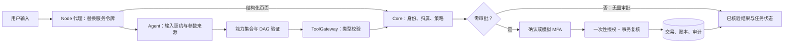

# 安全架构与执行控制

[返回文档总览](README.md) · [总体架构与完整数据流](Architecture.md#总体架构) · [数据内核](Algorithm.md)

完整组件图见[Architecture.md 的总体架构](Architecture.md#总体架构)。下图只标出安全判断发生的位置：结构化页面经代理直接访问 Core，聊天任务先由 Agent 验证计划；只有 Core 能确认业务授权和资金状态。



## 核心方法

### 身份边界与最小工具权限

浏览器经 Node 代理调用 Core 或 Agent。代理删除浏览器带来的 Cookie，并覆盖 `Authorization` 为服务端配置的令牌；Agent 再用服务端建立的执行上下文传给 ToolGateway。候选计划只可调用当前意图允许的动作，未知工具或超出能力集合的工具在执行前被拒绝。这样，模型文本不能自行变更用户身份，也不能仅靠输出一个工具名获得新的业务权限。当前身份实现主要服务于开发环境；代理令牌不是完整的用户登录方案。

```js
delete headers.cookie;
if (token) headers.authorization = `Bearer ${token}`;
else delete headers.authorization;
```

代码取自 [`frontend/aegis-pwa/server.mjs`](../frontend/aegis-pwa/server.mjs)；动作校验见 [`PlanVerifier.verify`](../agent/planning.py)。它对应图中的“代理 → Agent → 能力集合”。

### 参数来源、注入降级与结果约束

用户文本与模型输出都按候选数据处理。输入契约拦截明显的密码、验证码、CVV 与完整卡号；规则路由识别若干显式越权指令并转入安全降级。每个执行参数必须附有来源，模型推断值不能直接进入工具调用；未知工具和不符合 Schema 的输入也被拒绝。回答由已核验的工具结果组织，草稿的待审批状态不会写成“转账成功”。这些控制点限制了注入后果，但关键词和正则不能识别所有改写形式。

```python
if any(
    source.kind == ArgumentSourceKind.MODEL_INFERRED
    for source in step.argument_sources.values()
):
    raise PlanValidationError(
        "INFERRED_ARGUMENT", "model-inferred financial arguments are not executable"
    )
```

代码位置为 [`agent/planning.py`](../agent/planning.py)；另见 [`agent/privacy.py`](../agent/privacy.py)、[`agent/routing.py`](../agent/routing.py) 和 [`agent/responses.py`](../agent/responses.py)。它对应图中的“输入契约 → DAG 验证 → 已核验结果”。

### 风险审批与强验证

Core 的策略按动作分级。转账按 `Asia/Shanghai` 业务日累计草稿和已完成转出，累计不超过 1,000 元时要求明确确认，超过时要求模拟 MFA；储蓄罐出资按单次金额分级。审批绑定操作、操作者和请求哈希，有效期至多十分钟，发放的授权只能使用一次。提交时会重新核对授权所绑定的业务内容。红色操作的六位模拟验证码经过加盐 PBKDF2 哈希保存，挑战有效期五分钟；三次失败后锁定十五分钟。真实短信、人脸或 U 盾均未接入。

```python
tier = RiskTier.YELLOW if cumulative <= YELLOW_TRANSFER_LIMIT else RiskTier.RED
status = (
    PolicyStatus.REQUIRES_CONFIRMATION
    if tier == RiskTier.YELLOW
    else PolicyStatus.REQUIRES_MFA
)
```

代码取自 [`banking_core/app/security/policy.py`](../banking_core/app/security/policy.py)；授权和模拟 MFA 见 [`approvals.py`](../banking_core/app/security/approvals.py)。图中的“需审批？→ 一次性授权”由 Core 执行，Agent 无法自行批准。

### 资金原子性、幂等与账本

创建转账草稿不扣款。提交时 Core 锁定草稿及账户，在事务内重新核查有效期、归属、授权和余额，再写交易、借贷分录及余额。草稿按用户和幂等键设唯一约束，同一请求重试不会轻易变成第二笔草稿；请求摘要也用于识别同键但内容不一致的调用。账本每笔交易要求借贷汇总相等，PostgreSQL 迁移另禁止既有分录更新或删除。这里的原子性只覆盖 Core 数据库事务，不承诺多步骤 Agent 任务自动回滚。

```python
if Decimal(debit) != Decimal(credit):
    raise ConflictError("ledger transaction is not balanced")
```

代码见 [`ledger.py`](../banking_core/app/services/ledger.py)，事务和行锁见 [`transfers.py`](../banking_core/app/services/transfers.py)。它对应图中的“事务复核 → 交易、账本”。

### 审计、结果未知与安全锁定

ToolGateway 为工具调用记录状态、错误码、操作者和 Trace ID；Core 对审批及业务结果保存审计事件；Agent 另保存任务事件。写操作的 HTTP 结果若未知，运行图会按业务标识查询 Core：查到确定完成才报告完成，否则返回失败及待人工对账信息。此时不能仅因请求已经发出就向用户报告成功。模拟 MFA 的失败次数和临时锁定记录在 Core，防止同一挑战无限试码。这些记录帮助追踪请求，但不覆盖模型内部的每个推理步骤，也不是一套全局异常交易熔断器。

```python
if challenge.attempts >= challenge.max_attempts:
    lock.locked_until = datetime.now(UTC) + timedelta(minutes=15)
```

代码见 [`approvals.py`](../banking_core/app/security/approvals.py)；工具审计见 [`agent_tools/gateway.py`](../agent_tools/gateway.py)，未知结果处理见 [`agent/graph.py`](../agent/graph.py)。它对应图中的“交易、账本、审计 → 已核验结果”。

## 当前安全边界

当前 Agent 不运行模型生成代码，因此没有相应的代码执行沙箱。Core 与 Agent 在本地默认通过 HTTP 和静态开发服务令牌通信；仓库没有实现进程间 TLS/mTLS、生产用户认证或密钥托管。`JevRoutingBoundary` 的超时与熔断逻辑尚未接入在线 Agent。将 Aegis 部署到真实网络前，需要补齐这些基础能力，并以 PostgreSQL 集成测试验证数据库触发器、锁和并发行为。现有安全措施适用于模拟业务与原型验证，不能据此宣称已具备生产银行系统的防护等级。
