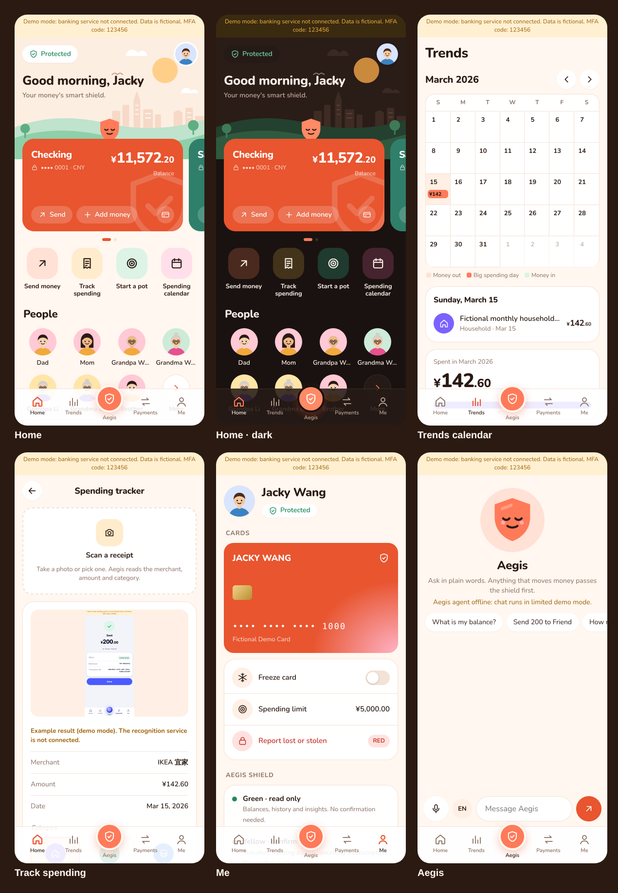

# Aegis: Your money's smart shield

The mobile front end for FinSAO, built as a **React + TypeScript PWA**. The same build ships as native **iOS and Android** apps through **Capacitor**.



## What's in it

| Tab | What it does | Backend |
|---|---|---|
| **Home** | Illustrated header with a greeting, swipeable balance cards, quick tiles (send, track spending, start a pot, calendar), a People grid, an "Ask Aegis" bar, a budget "shield check", activity and savings pots | `/accounts`, `/balance`, `/transactions`, `/subscriptions`, `/budgets/{id}/status`, `/savings-pots` |
| **Trends** | A month calendar showing money out (darker = bigger day) and money in per day; tap a day for its transactions. Below: spending by category and budgets with forecasts | `/analytics/monthly-summary`, `/budgets` |
| **Aegis** (centre) | Agent chat with a voice orb. It shows clarification forms, plan steps, and approvals for actions | Agent `/agent/tasks`, `/agent/tasks/{id}/resume` |
| **Track spending** | Scan a receipt (recognition service, see below) and match it to a bank transaction, or correct any transaction's category | `PATCH /transactions/{id}/category`, `/api/recognition/receipts` |
| **Payments** | Recipients, a big-amount send screen, and the shield approval. The receipt appears **only after `COMPLETED`**. You can also cancel subscriptions | `/beneficiaries`, `/transfers/drafts`, `/transfers/{id}/commit`, `/subscriptions/{id}/cancel` |
| **Me** | Cards (freeze, report lost), an explanation of the Green/Yellow/Red tiers, language (中文/EN), theme (system/light/dark), connection status, and an API log with trace IDs | `/cards/{id}/freeze`, `/unfreeze`, `/report-lost` |
| **Pot detail** | Full-bleed artwork, an add-money sheet, goal maths (per month, per week, months left), history, and a what-if calculator | `/savings-pots/{id}`, `/contributions` |

### The shield (`src/ui/Shield.tsx`)
Every sensitive action, whether from a screen or from chat, goes through one approval sheet. The tier always comes from the backend's `risk_tier`:

- **GREEN**: approved automatically.
- **YELLOW**: you check the details and confirm.
- **RED**: the backend sends a 6-digit MFA challenge (`/security/approvals/{id}/mfa`), and the code is verified with `/security/mfa/{id}/verify`.

Current backend policy:
- Transfers are Yellow until today's total passes ¥1,000, then Red.
- Card freeze and subscription cancel are Yellow.
- Report lost and wealth orders are Red.

## Team JSON rules this follows

- **Money**: always decimal strings (`"800.00"`), with integer-cent `BigInt` math in `src/core/money.ts`. No floats.
- **Trace IDs**: every request has `X-Trace-Id`. They are shown in **Me → API log**.
- **Idempotency**: transfer drafts send an `Idempotency-Key` header, and pots/contributions send `idempotency_key` in the body. There is **one key per intent**: retrying the same transfer reuses the key, and changing anything creates a new one.
- **`authorization_ref`**: kept in memory only and passed straight to the commit call. It is never stored or logged; the API log masks it (and MFA codes) as `••••••`.
- **Beneficiaries**: a new recipient must match an account number exactly. Nothing is guessed.
- **Spending categories**: `HOUSEHOLD, GROCERIES, TRANSPORT, ENTERTAINMENT, DINING, UNKNOWN`.
- **Not in the backend yet, so shown honestly as preview**:
  - "Add money" shows a "planned" toast.
  - The pot calculator is labelled "illustration only".
  - Voice uses the browser's own speech recognition.
- **Chat guards**: messages containing passwords, codes or card numbers are blocked before sending, and obvious prompt-injection attempts are refused.

## Look and feel

Warm and flat, following the team palette: cream background, deep brown text, coral accent, pink, and the Nunito font (bundled, so it works offline). The header scene, the mascot and the contact avatars are drawn in code (`src/ui/art.tsx`), so no image assets are needed.

- **Signed-in persona:** "Jacky Wang / 王杰" (`PROFILE` in `src/core/people.ts`).
- **Contacts:** the People grid uses the family accounts seeded in Banking Core (爸爸, 妈妈 and so on). Tapping a contact saves them as a recipient through the backend's exact account-number match.
- **Real photos:** put square images in `public/avatars/` and list them in `PHOTOS` in `src/core/people.ts`. Anyone without a photo keeps the illustration. Only use photos you have permission to use.

## Receipt recognition contract (for the recognition service)

The app sends the photo to `POST /api/recognition/receipts`. `server.mjs` (and `npm run dev`) forward that to `RECOGNITION_BACKEND_URL` + `/receipts`, adding `Authorization: Bearer $RECOGNITION_TOKEN` if one is set. When `RECOGNITION_BACKEND_URL` isn't set, the route answers 501 and the app says recognition isn't connected. In demo mode the app shows a labelled example instead.

Request: `multipart/form-data` with one file field named `receipt`.

Response (JSON):
```json
{ "merchant": "IKEA 宜家", "amount": "142.60", "currency": "CNY", "category": "HOUSEHOLD", "date": "2026-03-15", "confidence": 0.92 }
```
- `amount` is a decimal string, same as Banking Core.
- `category` is one of `HOUSEHOLD, GROCERIES, TRANSPORT, ENTERTAINMENT, DINING, UNKNOWN`.

The app then lists bank transactions with the same amount, and saves the chosen category with `PATCH /transactions/{id}/category`.

## Run it

You need Node 18+ and the backend from the repo root (see the main `README.md`).

```bash
cd frontend/aegis-pwa
npm install
```

**Dev, with hot reload.** Vite proxies `/api/core` → `:8000` and `/api/agent` → `:8100` and adds the service tokens:

```bash
npm run dev
```

**Production build, served the same way:**

```bash
npm run build && npm run serve
```

Open http://127.0.0.1:5174.

**No backend running?** The app switches to **demo mode** with fictional seed data, and the demo MFA code is `123456`. With the real backend, the MFA code is the `MOCK_MFA_CODE` in `.env`.

Proxy environment variables (shared by `vite.config.ts` and `server.mjs`):

`CORE_BACKEND_URL`, `AGENT_BACKEND_URL`, `BANKING_SERVICE_TOKEN`, `AGENT_API_TOKEN`, `RECOGNITION_BACKEND_URL`, `RECOGNITION_TOKEN`, `PORT`, `HOST`, `ALLOWED_ORIGINS`

The tokens are added **on the server**. The browser bundle never contains them.

**Test on your phone (same Wi-Fi):**

```bash
HOST=0.0.0.0 npm run serve
```

Then open `http://<your-computer-ip>:5174`. Installing it as an app ("Add to Home Screen") requires HTTPS or localhost.

### Checks

```bash
npm run typecheck
npm test
```

`npm test` covers money math, the token-adding proxy, path traversal and the CORS allowlist.

## iOS and Android (Capacitor)

`ios/` and `android/` are generated native projects that wrap the `dist/` build.

**iOS** needs a Mac with Xcode:

```bash
npm run cap:ios
```

**Android** needs Android Studio:

```bash
npm run cap:android
```

Inside the native app there is no same-origin proxy. Build with `VITE_API_BASE` pointing at a running `server.mjs` (or another gateway that adds the tokens server-side):

```bash
VITE_API_BASE=https://your-gateway.example npm run cap:sync
```

`server.mjs` accepts the native app origins (`capacitor://localhost`, `https://localhost`) and rejects any other cross-origin caller. Use HTTPS for the gateway. Android blocks plain HTTP by default.

Without `VITE_API_BASE`, the native app opens in demo mode.

## Layout

```
src/core/     framework-free TypeScript: API client, demo backend, money, i18n, formatting
src/ui/       shared React pieces: Shield (approval sheet), Sheet, Amount, TxRow
src/screens/  Home, Trends, Aegis, Pay, Pot, Activity, Me
src/app/      app state (language, theme, refresh, toast), hash router, shell + tab bar
public/       manifest, service worker (caches the app shell only, never /api), icons
server.mjs    static server + token-adding proxy + CORS allowlist for native apps
```

`src/core` has no React or DOM-rendering imports, so a future React Native/Expo app could reuse the API client, money rules and translations unchanged.

## Known limits

- **Incoming vs outgoing money**: Banking Core doesn't mark rows as debit or credit, so direction is inferred from the category (`src/core/format.ts`).
- **Agent in English**: with `MODEL_PROVIDER=offline`, the agent's rule-based router only understands Chinese phrasing (e.g. 查询余额). Connect an LLM provider in `.env` for free-form English.
- **Savings pots are virtual in the backend**: adding money to a pot (`POST /savings-pots/{id}/contributions`) doesn't deduct it from any account, doesn't check the balance, and has no approval tier. The app works around this: it shows "set aside · free" on Home, explains on the add sheet that nothing is moved, and blocks amounts above the free total (all balances minus all pots). That is a front-end check only. A real fix needs Banking Core to either move money to a savings account, or check the balance server-side and add a `savings.contribute` policy tier, so large amounts go through the shield like transfers.
- **Voice**: the browser's speech recognition hears one language at a time. The 中/EN button next to the mic switches it, separately from the app's language.
- **App store icons and splash screens**: still the Capacitor defaults. Generate them from `public/icons/icon.svg` with `@capacitor/assets`.
