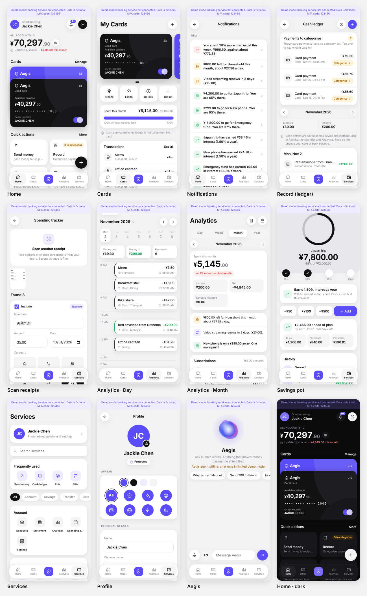

[中文](README.zh-CN.md) | English

# Aegis: Your money's smart shield

The mobile front end for Aegis, built as a **React + TypeScript PWA**. The same build ships as native **iOS and Android** apps through **Capacitor**.



## What's in it

Tabs: **Home · Cards · Aegis · Analytics · Services**.

| Screen | What it does | Backend |
|---|---|---|
| **Home** | Total balance (tap the eye to hide it), cards stacked like a wallet (tap one to bring it forward), quick actions, the Ask Aegis bar, reminders, upcoming bills, People and recent activity. Top right: the **notifications bell** (with an unread count) and the **receipt scan** button | `/accounts`, `/balance`, `/activity`, `/cards`, `/budgets`, `/subscriptions`, `/savings-pots` |
| **Notifications** | Bills due within a week, how far each savings goal still has to go, interest paid into pots, investment payouts (dividends, interest), spending this week against your usual, a category running above its usual, budget warnings and unusually large payments. Built on the device; read state is remembered locally | same data as Home |
| **Cards** | Card carousel, freeze, spending limit (Yellow), card details, report lost (Red), this month's spending against the limit | `/cards/{id}/freeze`, `/unfreeze`, `/limit`, `/report-lost` |
| **Record (cash ledger)** | Opened from the **Record** tile, which shows "N to categorise". At the top, **Payments to categorise** lists every card payment without a category, with a Categorise button. Below, record cash spending and income with a keypad (it does sums like `35+12`). A short "How the ledger works" card explains it the first time | `PATCH /transactions/{id}/category` |
| **Scan receipts** | Photo or screenshots from the library, several at once. A bill-list screenshot (Alipay / WeChat Pay style) gives one entry per payment. Edit the merchant, amount, date and category, use a matching bank payment, or save as cash expenses | `/expenses` (live), local OCR (see below) |
| **Analytics** | **Day**: a week strip and an hourly timeline of what you paid and when. **Week / Month / Year**: spent, income, net, pace against last period, budgets, category donut, cash flow, top merchants, subscriptions you can cancel | `/activity`, `/budgets/{id}/status`, `/subscriptions/{id}/cancel` |
| **Spending calendar** | The same day timeline as a full screen, with a date picker | `/activity` |
| **Aegis** (centre tab) | Agent chat with a living voice orb. Tapping the orb opens full-screen voice mode: words appear live and are sent when you stop | Agent `/agent/tasks`, `/agent/tasks/{id}/resume` |
| **Send money** | People and recipients, an amount screen, shield approval; the receipt appears **only after `COMPLETED`**. Backing out at the shield cancels the draft | `/beneficiaries`, `/transfers/drafts`, `/transfers/{id}/commit`, `/transfers/{id}/cancel` |
| **Savings pots** | Progress ring, milestones, on-track check, quick add, funded deposits through the shield, history, **interest rate and interest earned**. Plans: fixed goal, flexible, 52-week and 365-day challenges | `/savings-pots`, `/contributions`, `/savings-pots/{id}/interest` |
| **Wealth** | Net worth (cash + pots + investments), a 5-question risk profile, products with buy/sell (Red tier) | `/wealth/*` |
| **Services** | Profile card, search, frequently used, and every feature grouped by tab (Account, Savings, Transfer, Card, Payment, Wealth, Ledger) | — |
| **Profile** | Photo (from the library, resized on the device) or an icon and colour, name, Chinese name, gender, birthday, phone; then the Green/Yellow/Red tiers, language (中文/EN), theme, connection status and an API log with trace IDs | stored on the device |

### The shield (`src/ui/Shield.tsx`)
Every sensitive action, whether from a screen or from chat, goes through one approval sheet. The tier always comes from the backend's `risk_tier`:

- **GREEN**: approved automatically.
- **YELLOW**: you check the details and confirm.
- **RED**: the backend sends a 6-digit MFA challenge (`/security/approvals/{id}/mfa`), and the code is verified with `/security/mfa/{id}/verify`.

Current backend policy:
- **Transfers** are Yellow while **today's total, including this one, is ¥1,000 or less**, and Red above that. So ¥100 can be Red if you already sent ¥1,000 today. Pending drafts count only until they expire (15 minutes), and backing out cancels them.
- **Pot deposits** are Yellow up to ¥1,000, Red above.
- **Card freeze, card limit and subscription cancel** are Yellow.
- **Report lost and wealth orders** are Red.

## Team JSON rules this follows

- **Money**: always decimal strings (`"800.00"`), with integer-cent `BigInt` math in `src/core/money.ts`. No floats.
- **Trace IDs**: every request has `X-Trace-Id`. They are shown in **Profile → API log**.
- **Idempotency**: transfer drafts send an `Idempotency-Key` header, and pots/contributions send `idempotency_key` in the body. There is **one key per intent**: retrying the same transfer reuses the key, and changing anything creates a new one.
- **`authorization_ref`**: kept in memory only and passed straight to the commit call. It is never stored or logged; the API log masks it (and MFA codes) as `••••••`.
- **Beneficiaries**: a new recipient must match an account number exactly. Nothing is guessed.
- **Spending categories**: the backend taxonomy (`HOUSEHOLD, GROCERIES, TRANSPORT, ENTERTAINMENT, SUBSCRIPTIONS, DINING, UTILITIES, HEALTHCARE, EDUCATION, CHILDCARE, TRAVEL, SHOPPING, PERSONAL_CARE, PETS, GIFTS, INSURANCE, TAXES, FEES, REPAIRS, OTHER`). `UNKNOWN` means "not categorised yet" and is never offered as a choice.
- **Direction**: comes from the backend's `direction` on `/activity`. A transfer to another customer is money out; a transfer between your own accounts, into a pot or into an investment is a move and doesn't count as spending.
- **Chat guards**: messages containing passwords, codes or card numbers are blocked before sending, and obvious prompt-injection attempts are refused.

## Look and feel

Minimal and flat: white, black and one purple (`#5b4cf5`), with green/red only for money in and out, and the system font. No emojis: everything uses line icons. Bank cards are drawn in CSS (black, purple and white finishes, `src/ui/BankCard.tsx`). Charts use shades of the purple. Light and dark themes.

Demo mode (no backend) ships about three months of fictional activity relative to today, including monthly fund dividends (`src/core/mockdata.ts`). Live mode shows only what Banking Core returns.

- **Signed-in persona:** "Jackie Chen" by default; the Profile screen changes the name and picture on the device.
- **Contacts:** the People grid uses the family accounts seeded in Banking Core (爸爸, 妈妈 and so on). Tapping a contact saves them as a recipient through the backend's exact account-number match.
- **Real photos for contacts:** put square images in `public/avatars/` and list them in `PHOTOS` in `src/core/people.ts`. Anyone without a photo keeps the illustration. Only use photos you have permission to use.

## Receipt and voice recognition

**Receipts are read on the device by default.** Tesseract (Chinese + English) runs in a browser worker, and the photo never leaves the phone.
- The engine and language files (16 MB) are copied into `public/ocr` by `npm run dev` / `npm run build`. They are served by the app itself, never from a foreign CDN, so this works in mainland China. After the first scan it also works offline.
- Before reading, the picture is turned grey and darkened, so faint grey dates and labels in screenshots can be read.
- `src/core/receipt.ts` then finds:
  - the shop name: from labels like 商户全称 or 收款方, or from the top of the receipt, skipping greetings, order numbers and the phone's status bar
  - the total
  - the date
  - a category, scored by the shop name and the payment app's own label (餐饮美食, 交通出行…)
  - every row of a bill list

  Its tests are in `tests/receipt.test.mjs`.

**Optional backend recognition.** If `VITE_MULTIMEDIA_BACKEND=true` and the Agent is live, the app first calls the backend and falls back to local OCR on any failure:

```text
POST /api/agent/receipts/parse        multipart/form-data: upload=<image>
POST /api/agent/audio/transcribe      multipart/form-data: upload=<audio>
```

Receipt response:

```json
{ "items": [ { "merchant": "Cafe", "amount": "18.50", "currency": "CNY", "date": "2026-11-01", "category": "DINING" } ] }
```

Both endpoints are off by default. Turn them on with `MULTIMEDIA_ENABLED=true` and the `MULTIMEDIA_VISION_*` / `MULTIMEDIA_SPEECH_*` variables in the repository `.env.example`. Failures return `503 MULTIMEDIA_UNAVAILABLE`, and the app keeps its local fallback.

**Voice** uses the browser's speech recognition first. If that's unavailable and `VITE_MULTIMEDIA_BACKEND=true`, the app records audio and uses the transcribe endpoint.

## Run it

You need **Node 22.12+**. For live data you also need the backend from the repo root (Python 3.12, PostgreSQL via Docker; see the main `README.md`).

```bash
cd frontend/aegis-pwa
npm ci
```

**Demo mode, no backend.** If Banking Core can't be reached, the app switches to demo mode by itself. It uses fictional data, a purple banner at the top, and MFA code `123456`:

```bash
npm run dev
```

**Everything live.** Start Banking Core (`:8000`) and the Agent (`:8100`) from the repo root first. The app's server adds the service tokens and proxies `/api/core` → `:8000` and `/api/agent` → `:8100`:

```bash
npm run build && npm run serve
```

Open http://127.0.0.1:5174. **No purple "Demo mode" banner** means it's connected. With the real backend, the MFA code is `MOCK_MFA_CODE` from `.env`.

`npm run serve` serves the build that existed when it started, so restart it after each `npm run build`.

**On a phone (same Wi-Fi):**

```bash
HOST=0.0.0.0 npm run serve
```

Then open `http://<your-computer-ip>:5174`. Get the IP on a Mac with `ipconfig getifaddr en0`. iPhones only allow the microphone on HTTPS, so use the native app (below) to demo voice.

Proxy environment variables (shared by `vite.config.ts` and `server.mjs`):

`CORE_BACKEND_URL`, `AGENT_BACKEND_URL`, `BANKING_SERVICE_TOKEN`, `AGENT_API_TOKEN`, `RECOGNITION_BACKEND_URL`, `RECOGNITION_TOKEN`, `PORT`, `HOST`, `ALLOWED_ORIGINS`

The tokens are added **on the server**. The browser bundle never contains them.

### Checks

```bash
npm run typecheck
npm test
```

`npm test` covers money math, the token-adding proxy, path traversal, the CORS allowlist and the receipt parser.

## iOS and Android (Capacitor)

`ios/` and `android/` are generated native projects that wrap the `dist/` build. Inside the native app there is no same-origin proxy, so build it with `VITE_API_BASE` pointing at a running `server.mjs`. Without it, the native app opens in demo mode.

**iOS Simulator with the live backend** (keep `npm run serve` running):

```bash
VITE_API_BASE=http://localhost:5174 npm run cap:ios
```

**Real iPhone** (same Wi-Fi; start the server with `HOST=0.0.0.0 npm run serve`):

```bash
VITE_API_BASE=http://<your-mac-ip>:5174 npm run cap:ios
```

Xcode opens. Under **App → Signing & Capabilities**, choose your Team, pick a simulator or your iPhone, and press ▶. On a phone, the first launch needs **Settings → General → VPN & Device Management → Trust**.

- **Plain HTTP:** `Info.plist` allows plain HTTP to the local network only (`NSAllowsLocalNetworking`). Use HTTPS for any gateway on the internet.
- **Permissions:** the camera, photo library, microphone and speech permission texts are set for iOS. Android has `CAMERA` and `RECORD_AUDIO`.
- **Recording a demo:** in the Simulator, choose **File → Record Screen**.

**Android** needs Android Studio (`npm run cap:android`). Android blocks plain HTTP by default, so point `VITE_API_BASE` at an HTTPS gateway.

`server.mjs` accepts the native app origins (`capacitor://localhost`, `https://localhost`) and rejects any other cross-origin caller.

## Layout

```
src/core/     framework-free TypeScript: API client, demo backend, money, i18n, formatting,
              receipt parser, notifications, cash ledger, profile store
src/ui/       shared React pieces: Shield (approval sheet), Sheet, BankCard, voice orb, avatars
src/screens/  Home, Cards, Inbox, Ledger, Track (scan), Insights, Calendar, Aegis, Pay, Pot,
              Wealth, Services, Me (profile), Activity
src/app/      app state (language, theme, refresh, toast), hash router, shell + tab bar
public/       manifest, service worker (caches the app shell only, never /api), icons
scripts/      copy-ocr.mjs: puts the OCR engine and language files in public/ocr
server.mjs    static server + token-adding proxy + CORS allowlist for native apps
```

`src/core` has no React or DOM-rendering imports, so a future React Native/Expo app could reuse the API client, money rules and translations unchanged.

## Known limits

- **Device-only data:** manual cash-ledger entries, the profile (name, photo, gender), pot colours and icons, and which notifications were read are all stored on the device. Scanned receipts are saved to Banking Core (`/expenses`) when it is live.
- **Cash in budgets:** cash entries count in Analytics, the calendar and notifications, but not in Banking Core's budget status.
- **Agent language:** with `MODEL_PROVIDER=offline`, the agent's rule-based router mainly understands set phrasings. Connect an LLM provider in `.env` (for example DeepSeek) for free-form chat.
- **Investment returns:** Banking Core has no prices, so the tracker shows invested amounts and allocation. Payouts appear as incoming `INTEREST` transactions.
- **Voice:** the browser's speech recognition hears one language at a time. The 中/EN button next to the mic switches it. Inside the native iOS app, speech-to-text may be unavailable, depending on the iOS version.
- **App store icons and splash screens:** still the Capacitor defaults. Generate them from `public/icons/icon.svg` with `@capacitor/assets`.
