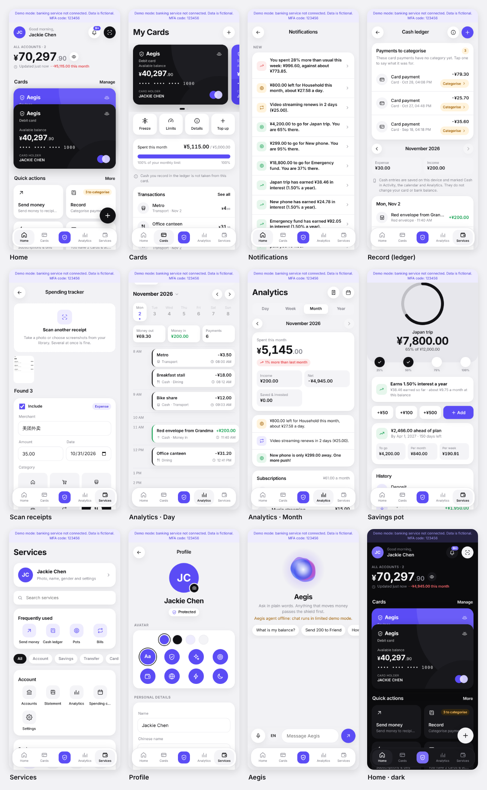

中文 | [English](README.md)

# Aegis：你的智能资金护盾

Aegis 的移动端前端，使用 **React + TypeScript** 构建的 **PWA**。同一套构建产物通过 **Capacitor** 打包为原生 **iOS 和 Android** 应用。



## 功能一览

底部标签：**首页 · 银行卡 · Aegis · 分析 · 服务**。

| 页面 | 功能 | 后端接口 |
|---|---|---|
| **首页** | 总余额（点眼睛图标可隐藏）、像钱包一样叠放的银行卡（点一下切到最前）、快捷操作、问 Aegis 输入栏、提醒、即将到期的账单、联系人和最近交易。右上角：**消息铃铛**（显示未读数）和**扫描小票**按钮 | `/accounts`、`/balance`、`/activity`、`/cards`、`/budgets`、`/subscriptions`、`/savings-pots` |
| **消息** | 一周内到期的账单、每个储蓄目标还差多少、储蓄罐利息、投资收益（分红、利息）、本周支出与平时对比、本月某个分类明显高于平时、预算提醒和异常大额支出。在设备上生成，已读状态保存在本机 | 与首页相同的数据 |
| **银行卡** | 卡片轮播、冻结、消费限额（黄色）、卡片详情、挂失（红色）、本月消费与限额对比 | `/cards/{id}/freeze`、`/unfreeze`、`/limit`、`/report-lost` |
| **记账（现金账本）** | 从首页「记一笔」卡片进入，卡片上会显示「N 笔待分类」。顶部的**待分类的消费**列出所有还没有分类的刷卡消费，每笔都有「分类」按钮。下方用数字键盘记录现金收支（支持 `35+12` 这样的加减）。第一次打开时会显示「记账本怎么用」说明 | `PATCH /transactions/{id}/category` |
| **扫描小票** | 拍照或从相册选择截图，可一次选多张。账单列表截图（支付宝 / 微信支付样式）会拆成每笔一条。可修改商户、金额、日期和分类，匹配银行交易，或保存为现金支出 | `/expenses`（连接后端时）、本地 OCR（见下文） |
| **分析** | **日**：一周日期条和按小时排列的时间轴，显示每笔钱在什么时间花在哪里。**周 / 月 / 年**：支出、收入、净额、与上期对比、预算、分类环形图、现金流、常去商户、可取消的订阅 | `/activity`、`/budgets/{id}/status`、`/subscriptions/{id}/cancel` |
| **消费日历** | 全屏版的日时间轴，可选择日期 | `/activity` |
| **Aegis**（中间标签） | 智能体对话，带会动的语音光球。点光球进入全屏语音模式：说话内容实时显示，停下后自动发送 | Agent `/agent/tasks`、`/agent/tasks/{id}/resume` |
| **转账** | 联系人和收款人、金额页、护盾审批；**只有状态为 `COMPLETED` 时**才显示转账回执。在护盾页取消会同时撤销草稿 | `/beneficiaries`、`/transfers/drafts`、`/transfers/{id}/commit`、`/transfers/{id}/cancel` |
| **储蓄罐** | 进度环、里程碑、是否按计划、快速存入、经护盾审批的存款、历史记录、**年利率和已获利息**。计划类型：固定目标、灵活存、52 周挑战、365 天挑战 | `/savings-pots`、`/contributions`、`/savings-pots/{id}/interest` |
| **财富** | 净资产（现金 + 储蓄罐 + 投资）、5 道题的风险测评、理财产品申购 / 赎回（红色） | `/wealth/*` |
| **服务** | 个人资料卡片、搜索、常用功能，以及按分组（账户、储蓄、转账、银行卡、缴费、理财、记账）列出的全部功能 | — |
| **个人资料** | 头像（从相册选择，在设备上压缩）或图标加颜色、英文名、中文名、性别、生日、手机号；下方是绿 / 黄 / 红风险等级说明、语言（中文 / EN）、主题、连接状态，以及带 Trace ID 的 API 日志 | 保存在本机 |

### 护盾（`src/ui/Shield.tsx`）
所有敏感操作，无论来自页面还是对话，都经过同一个审批弹窗。风险等级始终以后端返回的 `risk_tier` 为准：

- **绿色 GREEN**：自动通过。
- **黄色 YELLOW**：核对详情后确认。
- **红色 RED**：后端发起 6 位验证码挑战（`/security/approvals/{id}/mfa`），再通过 `/security/mfa/{id}/verify` 验证。

当前后端策略：
- **转账**：**当天累计转出（含本笔）不超过 ¥1,000** 时为黄色，超过为红色。所以如果今天已经转出 ¥1,000，再转 ¥100 也会是红色。未完成的草稿只在 15 分钟有效期内计入，在护盾页取消会立即撤销。
- **储蓄罐存入**：¥1,000 以内为黄色，以上为红色。
- **冻结银行卡、调整限额、取消订阅**：黄色。
- **挂失、理财申购和赎回**：红色。

## 遵循的团队 JSON 约定

- **金额**：一律使用十进制字符串（`"800.00"`），在 `src/core/money.ts` 中用整数分的 `BigInt` 计算，不使用浮点数。
- **Trace ID**：每个请求都带 `X-Trace-Id`，可在 **个人资料 → API 日志** 中查看。
- **幂等**：转账草稿在请求头中带 `Idempotency-Key`，储蓄罐和存款在请求体中带 `idempotency_key`。**一个意图一个键**：重试同一笔转账会复用同一个键，任何内容改变都会生成新键。
- **`authorization_ref`**：只保存在内存中，直接传给提交接口，从不存储或记录；API 日志会把它（以及验证码）显示为 `••••••`。
- **收款人**：新收款人必须与账号完全匹配，不做任何猜测。
- **消费分类**：使用后端分类表（`HOUSEHOLD, GROCERIES, TRANSPORT, ENTERTAINMENT, SUBSCRIPTIONS, DINING, UTILITIES, HEALTHCARE, EDUCATION, CHILDCARE, TRAVEL, SHOPPING, PERSONAL_CARE, PETS, GIFTS, INSURANCE, TAXES, FEES, REPAIRS, OTHER`）。`UNKNOWN` 表示「尚未分类」，不会作为选项出现。
- **资金方向**：以后端 `/activity` 返回的 `direction` 为准。转给其他客户算作支出；在自己账户之间、存入储蓄罐或买入理财算作资金转移，不计入支出。
- **对话防护**：含密码、验证码或卡号的消息会在发送前被拦截，明显的提示词注入会被拒绝。

## 视觉风格

简约扁平：白、黑和一种紫色（`#5b4cf5`），绿 / 红只用于表示收入和支出，使用系统字体。不使用 emoji，全部用线条图标。银行卡用 CSS 绘制（黑、紫、白三种卡面，`src/ui/BankCard.tsx`）。图表使用紫色的不同深浅。支持浅色和深色主题。

演示模式（无后端）自带以今天为基准、约三个月的虚构交易，包括每月的基金分红（`src/core/mockdata.ts`）。真实模式只显示 Banking Core 返回的数据。

- **登录用户**：默认为「Jackie Chen」；可在个人资料页修改姓名和头像（保存在本机）。
- **联系人**：联系人列表使用 Banking Core 预置的家人账户（爸爸、妈妈等）。点击联系人会通过后端的账号精确匹配将其保存为收款人。
- **联系人真实照片**：把方形图片放到 `public/avatars/`，并在 `src/core/people.ts` 的 `PHOTOS` 中登记。没有照片的联系人显示插画头像。只使用获得授权的照片。

## 小票与语音识别

**默认在设备上识别小票。** Tesseract（中文 + 英文）在浏览器 worker 中运行，照片不会离开手机。
- 识别引擎和语言文件（16 MB）由 `npm run dev` / `npm run build` 复制到 `public/ocr`，由应用自己提供，不依赖境外 CDN，因此在中国大陆可用。第一次扫描后可离线使用。
- 识别前会把图片转为灰度并加深，让截图中浅灰色的日期和标签也能识别。
- 随后由 `src/core/receipt.ts` 提取：
  - 商户名：优先读取「商户全称」「收款方」等字段，否则取小票顶部的店名，并跳过欢迎语、订单号和手机状态栏
  - 合计金额
  - 日期
  - 分类：主要根据商户名和支付应用自带的分类标签（餐饮美食、交通出行等）判断
  - 账单列表中的每一行

  对应测试在 `tests/receipt.test.mjs`。

**可选的后端识别。** 当 `VITE_MULTIMEDIA_BACKEND=true` 且 Agent 在线时，应用会先调用后端，任何失败都会回退到本地 OCR：

```text
POST /api/agent/receipts/parse        multipart/form-data: upload=<image>
POST /api/agent/audio/transcribe      multipart/form-data: upload=<audio>
```

小票识别返回：

```json
{ "items": [ { "merchant": "Cafe", "amount": "18.50", "currency": "CNY", "date": "2026-11-01", "category": "DINING" } ] }
```

这两个接口默认关闭。设置 `MULTIMEDIA_ENABLED=true` 以及仓库 `.env.example` 中的 `MULTIMEDIA_VISION_*` / `MULTIMEDIA_SPEECH_*` 变量即可开启。失败时返回 `503 MULTIMEDIA_UNAVAILABLE`，应用会继续使用本地回退方案。

**语音**优先使用浏览器自带的语音识别。如果不可用且 `VITE_MULTIMEDIA_BACKEND=true`，应用会录音并调用转写接口。

## 运行

需要 **Node 22.12+**。如需真实数据，还要从仓库根目录启动后端（Python 3.12，通过 Docker 运行 PostgreSQL，详见根目录 `README.md`）。

```bash
cd frontend/aegis-pwa
npm ci
```

**演示模式（无需后端）。** 连接不上 Banking Core 时，应用会自动进入演示模式：使用虚构数据，顶部有紫色提示条，验证码为 `123456`：

```bash
npm run dev
```

**完整真实环境。** 先在仓库根目录启动 Banking Core（`:8000`）和 Agent（`:8100`）。应用服务器会在服务端添加服务令牌，并把 `/api/core` 代理到 `:8000`、`/api/agent` 代理到 `:8100`：

```bash
npm run build && npm run serve
```

打开 http://127.0.0.1:5174。**没有紫色「演示模式」提示条**就说明已连接。使用真实后端时，验证码是 `.env` 中的 `MOCK_MFA_CODE`。

`npm run serve` 使用它启动时的构建产物，所以每次 `npm run build` 之后都要重启它。

**在手机上打开（同一 Wi-Fi）：**

```bash
HOST=0.0.0.0 npm run serve
```

然后打开 `http://<电脑的 IP>:5174`。在 Mac 上可用 `ipconfig getifaddr en0` 查看 IP。iPhone 只允许 HTTPS 页面使用麦克风，所以演示语音请使用原生应用（见下文）。

代理相关的环境变量（`vite.config.ts` 和 `server.mjs` 共用）：

`CORE_BACKEND_URL`、`AGENT_BACKEND_URL`、`BANKING_SERVICE_TOKEN`、`AGENT_API_TOKEN`、`RECOGNITION_BACKEND_URL`、`RECOGNITION_TOKEN`、`PORT`、`HOST`、`ALLOWED_ORIGINS`

令牌**在服务端**添加，浏览器端的代码中不包含任何令牌。

### 检查

```bash
npm run typecheck
npm test
```

`npm test` 覆盖金额计算、添加令牌的代理、路径穿越、CORS 白名单和小票解析。

## iOS 和 Android（Capacitor）

`ios/` 和 `android/` 是包装 `dist/` 构建产物的原生工程。原生应用中没有同源代理，因此构建时要用 `VITE_API_BASE` 指向正在运行的 `server.mjs`。不设置时，原生应用会以演示模式打开。

**iOS 模拟器 + 真实后端**（保持 `npm run serve` 运行）：

```bash
VITE_API_BASE=http://localhost:5174 npm run cap:ios
```

**真机 iPhone**（同一 Wi-Fi；服务器用 `HOST=0.0.0.0 npm run serve` 启动）：

```bash
VITE_API_BASE=http://<Mac 的 IP>:5174 npm run cap:ios
```

Xcode 会自动打开。在 **App → Signing & Capabilities** 中选择你的 Team，选择模拟器或你的 iPhone，然后点 ▶。真机第一次运行需要到 **设置 → 通用 → VPN 与设备管理** 中点「信任」。

- **明文 HTTP**：`Info.plist` 只允许对本地网络使用明文 HTTP（`NSAllowsLocalNetworking`）。互联网上的网关请使用 HTTPS。
- **权限**：已为 iOS 设置相机、相册、麦克风和语音识别的权限说明；Android 已声明 `CAMERA` 和 `RECORD_AUDIO`。
- **录制演示视频**：在模拟器中选择 **File → Record Screen**。

**Android** 需要 Android Studio（`npm run cap:android`）。Android 默认禁止明文 HTTP，请把 `VITE_API_BASE` 指向 HTTPS 网关。

`server.mjs` 只接受原生应用的来源（`capacitor://localhost`、`https://localhost`），拒绝其他跨域请求。

## 目录结构

```
src/core/     不依赖框架的 TypeScript：API 客户端、演示后端、金额、多语言、格式化、
              小票解析、消息提醒、现金账本、个人资料
src/ui/       共享的 React 组件：护盾（审批弹窗）、底部弹窗、银行卡、语音光球、头像
src/screens/  首页、银行卡、消息、账本、扫描、分析、日历、Aegis、转账、储蓄罐、
              财富、服务、个人资料、交易记录
src/app/      应用状态（语言、主题、刷新、提示）、哈希路由、外壳和底部标签栏
public/       manifest、service worker（只缓存应用外壳，从不缓存 /api）、图标
scripts/      copy-ocr.mjs：把 OCR 引擎和语言文件放到 public/ocr
server.mjs    静态服务器 + 添加令牌的代理 + 原生应用的 CORS 白名单
```

`src/core` 不引用 React 或 DOM 渲染，未来的 React Native / Expo 应用可以直接复用 API 客户端、金额规则和翻译。

## 已知限制

- **仅保存在本机的数据**：手动记的现金账、个人资料（姓名、头像、性别）、储蓄罐的颜色和图标、消息的已读状态都保存在设备上。连接 Banking Core 时，扫描的小票会保存到后端（`/expenses`）。
- **现金与预算**：现金支出会计入分析、日历和消息提醒，但不计入 Banking Core 的预算状态。
- **智能体语言**：`MODEL_PROVIDER=offline` 时，智能体的规则路由主要识别固定说法。如需自由对话，请在 `.env` 中接入大模型（例如 DeepSeek）。
- **投资收益**：Banking Core 没有价格数据，理财页只显示投入金额和配置比例。收益以 `INTEREST` 类型的入账交易出现。
- **语音**：浏览器的语音识别一次只能听一种语言，麦克风旁边的「中 / EN」按钮可以切换。在原生 iOS 应用中，语音转文字可能因 iOS 版本而不可用。
- **应用商店图标和启动图**：目前仍是 Capacitor 默认图标。可用 `@capacitor/assets` 从 `public/icons/icon.svg` 生成。
