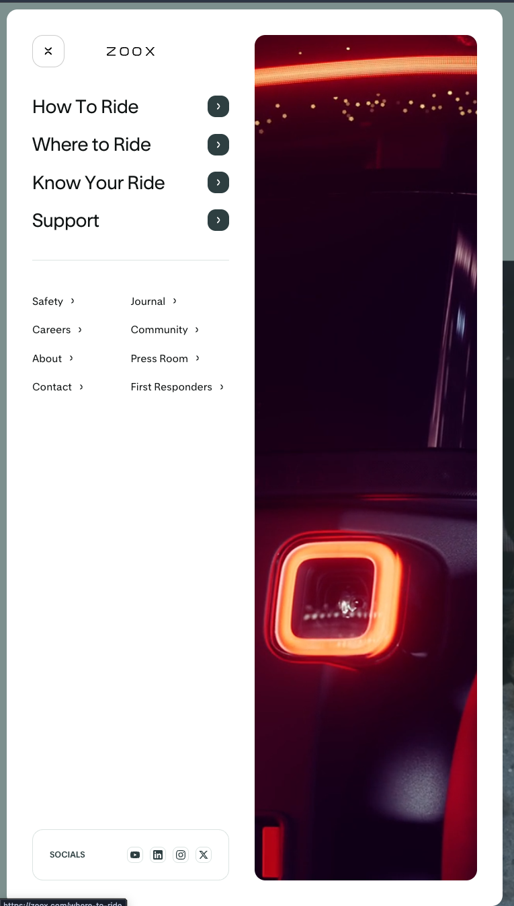
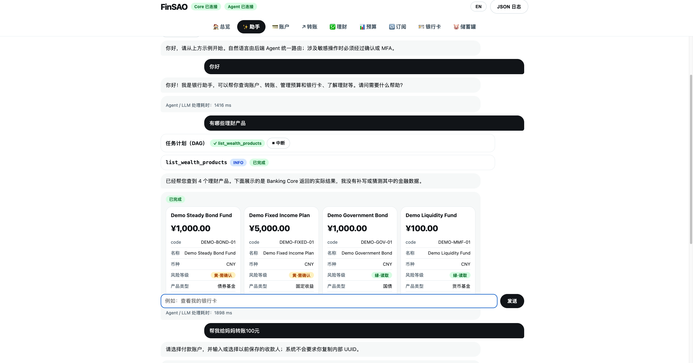
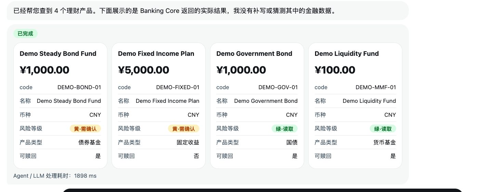
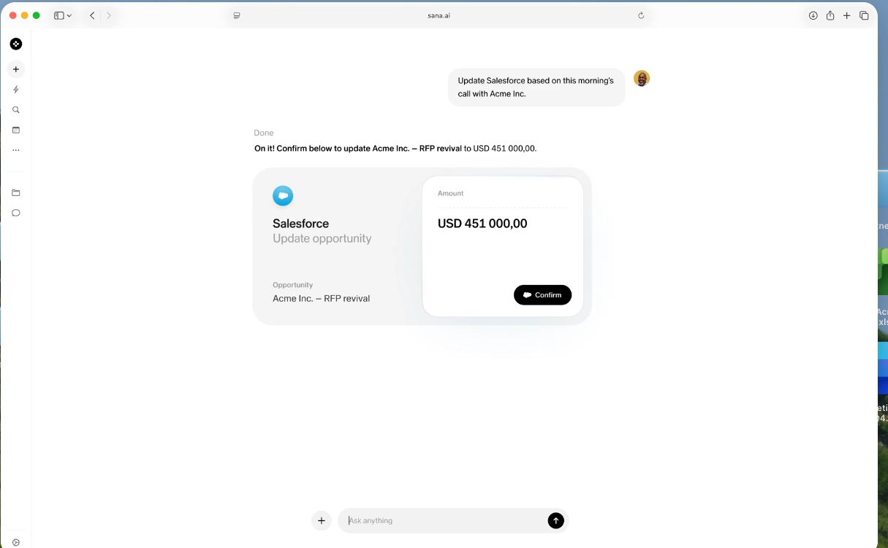

# task 1
修改顶部nav bar成为侧边bar，风格参考如下：

同时需要你去掉emoji

# task 2 
当前的对话窗口如下

1. 当对话长于屏幕的时候，多的对话会藏在输入框下方，需要调整逻辑。
2. 当前生成表单如下，比较丑，请你使用impeccable的skill将其美化

使用impeccable的skill一并美化字体设计。
# task 3 颜色搭配
当前的页面颜色比较复杂
整体可以参考的设计思路和颜色搭配

# task 4 页面logo改名为Finpilot 

